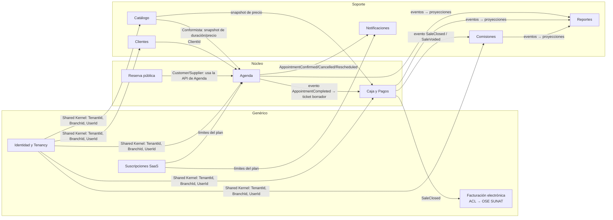
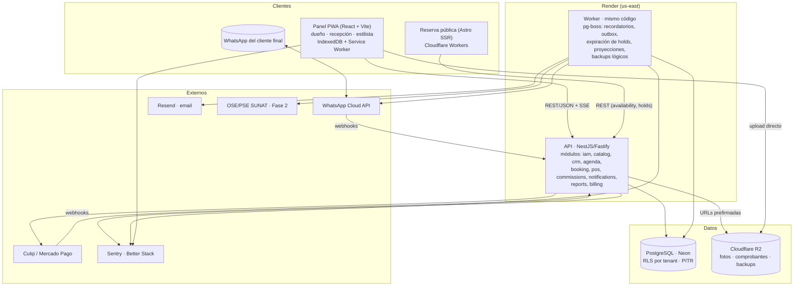
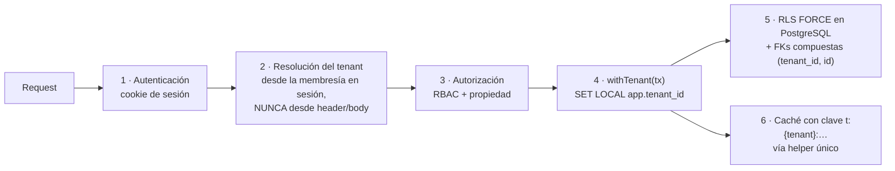
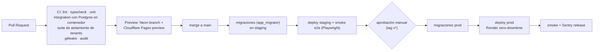
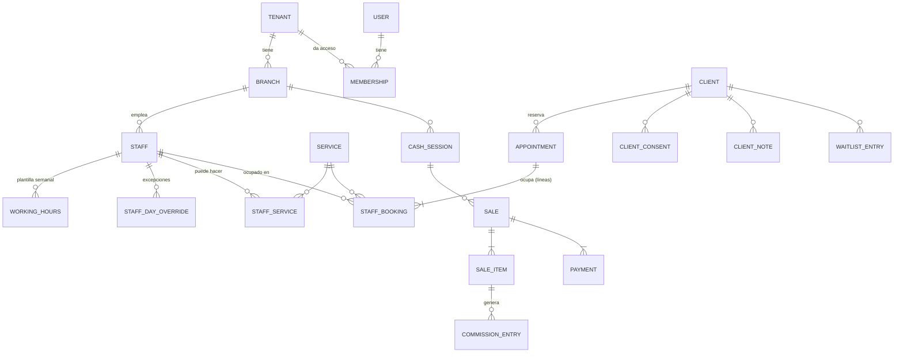
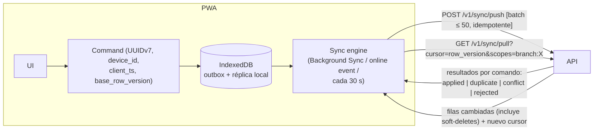
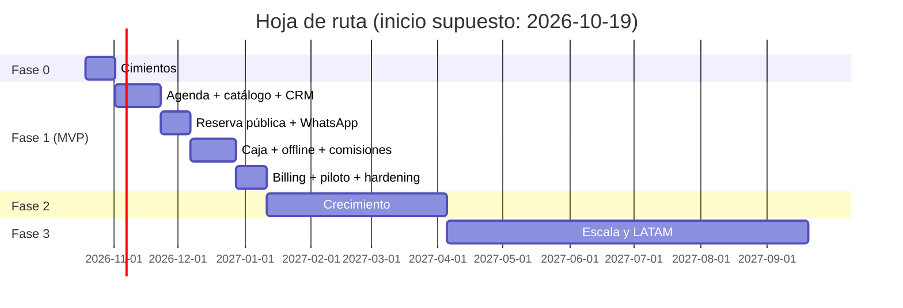

# Arquitectura — SaaS de gestión para peluquerías y salones (Perú → LATAM)

> Documento de arquitectura v1 · Octubre 2026
> Audiencia: equipo de 1–3 devs (uno junior). Objetivo: MVP vendible en 8–10 semanas, < 100 USD/mes de infraestructura, sin reescritura al escalar.

---

## 0. Resumen ejecutivo (las 12 decisiones que importan)

| # | Decisión | Descartado | Por qué |
|---|----------|-----------|---------|
| 1 | **Monolito modular** en TypeScript, un proceso API + un proceso worker | Microservicios, serverless puro | 1–3 devs no pueden operar N servicios; los límites se imponen en el código, no en la red |
| 2 | **PostgreSQL** gestionado (Neon) | Firestore | La invariante "no solapar citas" se resuelve con un `EXCLUDE` constraint; caja, comisiones y reportes son relacionales |
| 3 | **Multi-tenant: BD compartida + `tenant_id` + Row Level Security** | Esquema por tenant, BD por tenant | Costo y migraciones O(1); RLS da aislamiento en el motor, no en la disciplina del junior |
| 4 | **NestJS (adaptador Fastify) + contratos `ts-rest` + Zod** (REST + OpenAPI) | FastAPI, Django, GraphQL, tRPC | Un solo lenguaje entre PWA offline y API: los mismos esquemas Zod validan en el teléfono y en el servidor |
| 5 | **PWA React (Vite) offline-first** para el panel; **Astro SSR** para la página pública de reserva | App nativa, Next.js para todo | Android barato + datos móviles: PWA instalable, sin tienda; página pública con casi cero JS y previews de WhatsApp |
| 6 | **Cola en Postgres (`pg-boss`)** para recordatorios y tareas | BullMQ+Redis, Celery, SQS | Un componente menos que operar y pagar; suficiente hasta ~millones de jobs/día |
| 7 | **WhatsApp Cloud API directa (Meta)** + fallback gratuito `wa.me` + email (Resend) | Twilio/360dialog al inicio, SMS como canal principal | El canal real en Perú es WhatsApp; el SMS es caro y poco leído |
| 8 | **Better Auth** (sesiones en cookie httpOnly, guardadas en Postgres) + **RBAC con reglas de propiedad** | Firebase Auth, Auth0, ABAC completo | Sesiones revocables, sin costo por MAU, datos en nuestra BD; 4 roles no justifican un motor ABAC |
| 9 | **Cobro del SaaS: Culqi (tarjeta recurrente) + Yape/transferencia manual con período de gracia** | Stripe | Stripe no adquiere comercios peruanos y el barbero de barrio a menudo no tiene tarjeta de crédito |
| 10 | **Offline = outbox de comandos + IDs generados en cliente + idempotencia**; las ventas son *append-only* | CRDTs, Firestore offline, PowerSync en el MVP | Las ventas no generan conflictos; las citas se marcan en conflicto y las resuelve una persona |
| 11 | **Render (API+worker) + Neon + Cloudflare (Pages/Workers/R2)** ≈ 45–70 USD/mes | AWS/GCP "a mano", VPS propio | Cero administración de servidores, PITR incluido, sin costo de egress en archivos |
| 12 | **Sentry + Better Stack** (logs, uptime, alertas) | Stack Prometheus/Grafana propio | Planes gratuitos suficientes; nadie del equipo tiene que mantener la observabilidad |

**Suposiciones explícitas** (cámbialas si tienes el dato real):

- S1. ~85–90 % de los usuarios usa Android de gama media/baja; el iPhone es minoritario en barrio.
- S2. Un salón de 1–3 sillas hace 10–40 atenciones/día; parte relevante es **sin cita (walk-in)**.
- S3. Disposición a pagar: S/ 30–80 al mes por sucursal. Se valida antes de construir (ver §14).
- S4. Al inicio, un solo dispositivo hace de caja por sucursal.
- S5. Muchos clientes objetivo están en **Nuevo RUS** o RMT y hoy no emiten comprobante electrónico; SUNAT entra en la Fase 2, no en el MVP.

---

## 1. Análisis del dominio

### 1.1 Bounded contexts y clasificación

| Contexto | Responsabilidad | Tipo | Justificación |
|----------|----------------|------|---------------|
| **Agenda** (Scheduling) | Horarios de estilistas, bloqueos, citas, disponibilidad, retenciones (*holds*), lista de espera, cola de walk-ins | **Núcleo** | Es lo que se vende: menos huecos, menos ausencias (*no-shows*), menos llamadas |
| **Reserva pública** (Booking) | Enlace público del salón, flujo de reserva del cliente final, confirmación/cancelación | **Núcleo** (parte de Agenda, módulo propio) | Canal de adquisición; es la cara del producto en WhatsApp/Instagram |
| **Caja y Pagos** (POS) | Ventas (tickets), métodos de pago locales, apertura/cierre de caja, anulaciones | **Núcleo secundario** | Lo genérico es la caja; lo que diferencia es Yape/Plin, el uso offline y la conciliación |
| **Comisiones** | Reglas de comisión, cálculo por ítem vendido, liquidación por período | **Soporte** | Evita conflictos con los estilistas; el modelo "alquiler de silla" es típico en Perú |
| **Clientes** (CRM) | Ficha, historial, notas (incluidas las sensibles), fotos, consentimientos | **Soporte** | Necesario y poco diferenciador; lleva la carga legal de la Ley 29733 |
| **Catálogo** | Servicios, duración, precios, qué estilista hace qué | **Soporte** | Datos de referencia que usan Agenda y Caja |
| **Notificaciones** | Plantillas, envío por WhatsApp/email/SMS, *webhooks*, registro de entregas | **Soporte** | Infraestructura con reglas de negocio (ventana de 24 h de Meta, opt-in) |
| **Reportes** | Ingresos, ocupación, ausencias, ranking de estilistas | **Soporte** (read models) | Solo lee proyecciones; nunca escribe en los otros contextos |
| **Identidad y Tenancy** | Usuarios, membresías, roles, salones (tenants), sucursales | **Genérico** | Se resuelve con una librería + RLS |
| **Suscripciones del SaaS** (Billing) | Planes, límites, cobros al salón, período de gracia | **Genérico** | Se integra con Culqi y Nubefact; no se construye un motor propio |
| **Facturación electrónica** (Fase 2) | Boletas y facturas del salón a sus clientes ante SUNAT | **Genérico** detrás de una ACL | Se delega en un OSE/PSE (Nubefact u otro); en LATAM, un adaptador por país |

### 1.2 Mapa de contextos



**Regla de integración:** los módulos se comunican de dos formas. Para consultas síncronas, a través de la **fachada pública** del módulo (`modules/agenda/index.ts`). Para efectos secundarios, mediante **eventos de dominio** publicados con *transactional outbox*. Ningún módulo hace `SELECT` sobre las tablas de otro módulo.

### 1.3 Agregados e invariantes

| Contexto | Agregado (raíz) | Invariantes que el sistema **garantiza** |
|----------|-----------------|------------------------------------------|
| Agenda | `Appointment` (con sus `ServiceLines`) | **I1.** Un estilista no tiene dos ocupaciones activas que se solapen (citas, bloqueos y *holds* incluidos). Se aplica con un `EXCLUDE USING gist` en BD, no solo en código. **I2.** Una cita solo se crea dentro del horario laboral efectivo del estilista (validación de aplicación). **I3.** Transiciones de estado válidas: `held → confirmed → checked_in → completed`; `cancelled` y `no_show` son terminales. **I4.** Una línea de servicio solo se asigna a un estilista habilitado para ese servicio. **I5.** Un *hold* expira (5 min por defecto) y libera el espacio |
| Agenda | `StaffSchedule` (plantilla semanal + excepciones) | Los intervalos de un mismo día no se solapan; `start < end`; la zona horaria se toma de la sucursal |
| Agenda | `WaitlistEntry` | Una entrada activa por cliente, servicio y ventana; la oferta de un espacio caduca y pasa al siguiente |
| Caja | `CashSession` | **I6.** Máximo una sesión abierta por caja/dispositivo. **I7.** El cierre registra el efectivo esperado y el contado; la diferencia queda guardada y nunca se "corrige" |
| Caja | `Sale` (ticket con ítems y pagos) | **I8.** Inmutable una vez cerrada; se anula con un registro de anulación, nunca con `UPDATE` o `DELETE`. **I9.** Σ pagos = total al cerrar. **I10.** Los precios son *snapshots* del momento de la venta. **I11.** Idempotente por `id` generado en el cliente |
| Comisiones | `CommissionEntry` (append-only) y `Settlement` | **I12.** Toda comisión se deriva de un ítem de venta cerrado; una anulación genera una entrada negativa. **I13.** Un período liquidado no se modifica |
| Clientes | `Client` | **I14.** Teléfono único (E.164) por tenant entre los clientes activos. **I15.** No se envían recordatorios ni marketing sin el consentimiento de esa finalidad. **I16.** Las notas sensibles solo se guardan cifradas |
| Catálogo | `Service` | Duración > 0, múltiplo de la granularidad (5 min); precio ≥ 0 en céntimos |
| Identidad | `Tenant`, `Membership` | **I17.** Toda fila de negocio pertenece a exactamente un tenant. **I18.** Cada tenant tiene al menos un `owner` |

**Decisión de modelado clave:** las ocupaciones de un estilista (líneas de servicio, bloqueos, almuerzo, *holds*) viven en **una sola tabla** (`agenda.staff_bookings`). Así un único constraint de exclusión cubre todos los casos. Si estuvieran en tablas separadas, I1 dependería de un lock y de que el código no tenga errores.

---

## 2. Mercado y referentes

> Los datos de precios de terceros son volátiles. Las cifras de este apartado provienen de fuentes secundarias de 2026; verifícalas en las páginas oficiales antes de usarlas para posicionar el precio.

| Producto | Modelo | Lo que hace bien | Lo que conviene evitar |
|----------|--------|------------------|------------------------|
| **Fresha** | Fue "gratis + comisiones" durante años; según fuentes de 2026, desde 2025 cobra suscripción (~USD 14.95 por miembro del equipo o ~USD 19.95 individual) **más 20 % sobre clientes nuevos del marketplace** y procesamiento de tarjeta | Onboarding rapidísimo, enlace de reserva, POS integrado, *marketplace* | Depender del marketplace; las comisiones por cliente nuevo generan rechazo y hay quejas por costos ocultos |
| **Booksy** | Suscripción + "Boost" (comisión por cliente traído) | Muy fuerte en barberías; app del cliente; perfiles con fotos de trabajos | Precio por estilista, que castiga al salón pequeño; marketplace sin masa crítica en Perú |
| **Vagaro** | Suscripción por usuario + add-ons | POS, inventario, formularios, marketing; muy completo | Complejidad de menú en menú; pensado para EE. UU. |
| **Treatwell** | Marketplace europeo con comisión | Descubrimiento de clientes | El modelo marketplace no sirve sin demanda local |
| **Altegio** (ex-YCLIENTS intl.) | Suscripción por niveles de staff | Muy profundo: inventario, nómina, comisiones complejas, multi-sucursal | Curva de aprendizaje alta; UX de ERP |
| **AgendaPro** (Chile, opera en Perú) | Suscripción | Competidor regional real, en español, con recordatorios y pagos | Su precio y su foco en centros medianos dejan hueco en la barbería de barrio |
| **Cuaderno + WhatsApp + Excel** | Gratis | Cero fricción | **Es el competidor principal.** Si el producto es más lento que anotar en un cuaderno, pierde |

### 2.1 Patrones que se adoptan

1. **Enlace público de reserva** (`tu-app.pe/barberia-don-lucho`) para la bio de Instagram y el estado de WhatsApp. Sin que el cliente final tenga que instalar una app ni crear cuenta.
2. **Agenda en columnas por estilista** con arrastrar y soltar en escritorio y vista por día y estilista en el móvil.
3. **Recordatorio con botones "Confirmar / Cancelar"** dentro del mensaje (botones *quick reply* de WhatsApp).
4. **Del turno a la caja en un toque:** completar una cita genera el ticket borrador.
5. **Onboarding en menos de 10 minutos:** nombre del salón → servicios sugeridos por plantilla (barbería/peluquería/uñas) → horarios → enlace listo.

### 2.2 Patrones que se evitan

- **Precio por estilista** en el plan base. Se cobra por sucursal, que es lo que pidió el negocio y además encaja con el salón pequeño.
- **Comisión por cliente nuevo** o *marketplace* en el MVP: no hay demanda que justificarlo.
- **Pedir tarjeta para el plan gratis.**
- **Registro obligatorio del cliente final.** Basta con nombre y teléfono, verificado por WhatsApp solo si hace falta.

### 2.3 Diferenciadores para Perú

| Diferenciador | Cómo se materializa | Fase |
|---------------|---------------------|------|
| **WhatsApp como canal principal** | Recordatorios por Cloud API y, en el plan gratis, botón "Enviar por WhatsApp" que abre `wa.me/51…?text=…` desde el teléfono del salón (costo cero) | 1 |
| **Yape / Plin como métodos de cobro de primera clase** | En la caja: botón Yape/Plin con campo opcional "N.º de operación" para conciliar; QR del salón mostrado en pantalla | 1 |
| **Cola de walk-ins** ("turno virtual") | El barbero de barrio vive del cliente que llega sin cita: cola visible con tiempo estimado y enlace "te avisamos por WhatsApp cuando falten 2" | 1 (validar) |
| **Funciona con señal mala** | PWA offline: la caja cobra sin internet; la agenda del día se lee sin conexión | 1 |
| **Comisiones y alquiler de silla** | Reglas por porcentaje, monto fijo y "alquiler de silla" (el estilista paga una renta fija y se queda con sus ventas) | 1 (%), 2 (alquiler) |
| **Adelantos para reducir ausencias** | Depósito con Yape (vía Culqi) o Mercado Pago al reservar online | 2 |
| **Boleta/factura electrónica SUNAT** | Integración con un OSE/PSE (p. ej. Nubefact, con API REST JSON) usando las credenciales del salón | 2 |
| **Precios en soles y planes accesibles** | Plan gratis útil de verdad; plan básico en el rango de S/ 30–50 (hipótesis S3) | 1 |

---

## 3. Estilo arquitectónico

### 3.1 Decisión: monolito modular

| Opción | A favor | En contra para este equipo | Veredicto |
|--------|---------|---------------------------|-----------|
| **Monolito modular** | Un despliegue, una BD, transacciones locales (vitales para I1 e I8), *debug* simple, barato | Exige disciplina de límites, que se impone con herramientas | ✅ **Elegido** |
| Microservicios | Escalado y despliegue independientes | Transacciones distribuidas, *service mesh*, N pipelines, observabilidad distribuida; con 1–3 devs es suicidio operativo | ❌ |
| Serverless (Cloud Functions/Lambda + Firestore) | Cero servidores, escala a cero; el equipo conoce Firebase | Arranques en frío en la reserva pública; sin `EXCLUDE` constraint; consultas de reportes caras; difícil de testear localmente; *lock-in* | ❌ como núcleo. ✅ para piezas puntuales (Cloudflare Worker de la página pública) |

**Sobre Firebase:** su mejor argumento es la sincronización offline de Firestore, que es excelente. Se descarta porque el núcleo (no solapar citas, caja cuadrada, comisiones derivadas, reportes por período) es transaccional y relacional. En Firestore, I1 obliga a materializar un documento por *slot* y a hacer transacciones sobre ellos, un modelo frágil cuando cambia la granularidad. Firebase se conserva solo como **FCM** para notificaciones push al personal (Fase 2).

### 3.2 Componentes



### 3.3 Evolución sin reescritura

Las reglas que hacen posible extraer piezas más tarde se adoptan desde el día 1:

1. **Un esquema PostgreSQL por módulo** (`agenda.*`, `pos.*`, `crm.*`…). Es la frontera física del módulo y facilita moverlo a otra BD.
2. **Prohibido el acceso cruzado a tablas.** Se verifica en CI con `dependency-cruiser` (imports) y con una prueba que analiza el SQL de cada repositorio.
3. **Eventos de dominio con outbox transaccional.** Hoy los consume el mismo worker; mañana pueden ir a SQS, Pub/Sub o NATS sin tocar a los productores.
4. **IDs UUIDv7** y `tenant_id` en todas las filas. No hay secuencias globales que impidan mover un tenant.
5. **API versionada** (`/v1`) con contrato `ts-rest` y OpenAPI generado.

| Señal de crecimiento | Paso evolutivo |
|---------------------|----------------|
| > 300 req/s o CPU de la API > 70 % sostenido | Escalar horizontalmente la API (stateless); agregar Redis para caché y *rate limiting* |
| Reportes pesados que afectan la latencia de la agenda | Réplica de lectura para `reports`; luego *warehouse* (ClickHouse o BigQuery) alimentado por el outbox |
| > 1 M jobs/día o latencia de la cola | Mover las colas de `pg-boss` a BullMQ+Redis o SQS (la interfaz `JobQueue` ya lo abstrae) |
| Notificaciones con ritmo propio (campañas, varios números) | Extraer `notifications` como **primer servicio independiente**; ya se comunica solo por eventos |
| Cliente *enterprise* con requisito de aislamiento físico | Mover ese tenant a una BD dedicada ("silo bajo demanda"); el código no cambia |
| Expansión a México/Colombia/Chile | Nuevos adaptadores de facturación y pagos detrás de los mismos puertos; zona horaria y moneda ya están en `branch` |

---

## 4. Multi-tenancy

### 4.1 Comparativa

| Criterio | BD compartida + `tenant_id` | Esquema por tenant | BD por tenant |
|----------|----------------------------|--------------------|---------------|
| Costo por tenant | ~0 | Bajo, pero el catálogo de PG crece | Alto (mínimo de instancia o *compute* por BD) |
| Migraciones | 1 ejecución | N ejecuciones; falla parcial = drift | N ejecuciones y N conexiones |
| Tenants gratis (miles) | ✅ | ⚠️ miles de esquemas degradan `pg_catalog` y las herramientas | ❌ |
| Aislamiento | Lógico; **con RLS, en el motor** | Lógico por `search_path` (un error de `search_path` = fuga) | Físico |
| Reportes de plataforma | Triviales | `UNION` de N esquemas | ETL |
| Pooling de conexiones | Excelente | Problemático con `search_path` en modo transacción | Un pool por BD |
| Restaurar un solo tenant | Difícil (se hace por export lógico) | Fácil | Fácil |

**Recomendación: BD compartida + `tenant_id` + RLS forzada**, con la vía de escape "silo bajo demanda" para clientes grandes. Un modelo freemium con miles de salones de 1 silla hace inviable el esquema o la BD por tenant.

### 4.2 Aislamiento en capas (defensa en profundidad)



**Datos**

- Rol `app_runtime` **sin** `BYPASSRLS` y sin ser dueño de las tablas. Las migraciones corren con `app_migrator`.
- `ENABLE` + `FORCE ROW LEVEL SECURITY` en toda tabla con `tenant_id`.
- La política usa `NULLIF(current_setting('app.tenant_id', true), '')::uuid`. Si el contexto no está fijado, devuelve **cero filas** en lugar de un error o de todo.
- `SET LOCAL` dentro de una transacción por request, compatible con el *pooler* en modo transacción (PgBouncer de Neon).
- **FKs compuestas** `(tenant_id, client_id) → crm.clients(tenant_id, id)`: aunque alguien desactive RLS, el motor impide referenciar una fila de otro tenant.
- Los procesos de plataforma (backups, métricas globales) usan un rol separado `app_platform` con `BYPASSRLS`, solo en el worker, nunca expuesto a HTTP.

**Autorización**

- `TenantContext` (tenantId, branchIds, userId, role, staffId) se construye **una vez** en un *guard* de Nest y se inyecta. Ningún *handler* lee `tenant_id` del cliente.
- Cambiar de salón (un usuario puede trabajar en dos) = `POST /v1/session/active-tenant`; el servidor valida la membresía y rota la sesión.
- La página pública resuelve el tenant por `slug` y obtiene un contexto **restringido** (`role = public`). Solo puede consultar disponibilidad y crear *holds* o citas de esa sucursal.

**Caché**

- Al inicio no hay Redis; se usa caché en proceso (LRU) **solo** a través de `tenantCache(ctx).get(key)`, que antepone `t:{tenantId}:`. Una regla de ESLint prohíbe importar el cliente de caché directamente.
- La CDN (Cloudflare) cachea solo el contenido público sin datos personales (nombre del salón, servicios, fotos públicas). La disponibilidad lleva `Cache-Control: no-store` o, como mucho, 15 s con clave por sucursal y fecha.

**Prevención de fugas: controles automáticos en CI**

1. Prueba de catálogo: falla si alguna tabla con columna `tenant_id` no tiene `relrowsecurity` y `relforcerowsecurity`.
2. Suite "dos tenants": genera A y B con datos, ejecuta **cada endpoint** autenticado como A y verifica que no aparece ningún ID de B en la respuesta.
3. Prueba sin contexto: una consulta sin `SET LOCAL` debe devolver 0 filas.
4. Los logs y Sentry incluyen siempre `tenant_id` para detectar respuestas cruzadas.

---

## 5. Stack tecnológico

### 5.1 Frontend

| Pieza | Elección | Descartado y por qué |
|-------|----------|----------------------|
| Panel (dueño/recepción/estilista) | **React 19 + Vite + TanStack Router + TanStack Query**, **Tailwind + shadcn/ui**, PWA con `vite-plugin-pwa` (Workbox) | **Next.js**: el App Router y el SSR no aportan nada a una app autenticada offline-first y complican el *service worker*. **React Native/Flutter**: tienda de apps, dos bases de código, revisiones; la PWA en Android se instala desde el navegador |
| Datos offline | **Dexie (IndexedDB)** + outbox de comandos propio (§8) | **RxDB/PouchDB**: modelo documental que choca con el backend relacional. **PowerSync/ElectricSQL**: buena opción si la sincronización propia se vuelve un problema (Fase 2–3), pero agrega costo y una pieza más |
| Página pública de reserva | **Astro SSR en Cloudflare Workers** con una isla React para el selector de horario | **SPA**: mal *first paint* en 3G y sin *Open Graph* dinámico (la vista previa en WhatsApp/Instagram necesita `og:title`/`og:image` renderizados en el servidor). **Next.js en Vercel**: el plan Hobby no permite uso comercial y el Pro cuesta USD 20/usuario |
| Formularios y validación | **React Hook Form + Zod**; los esquemas viven en `packages/contracts` y se comparten con la API | — |
| i18n | `es-PE` por defecto; formateo con `Intl` (moneda y zona de la sucursal) | — |

**Objetivos de rendimiento:** página pública con < 60 KB de JS e interactiva en menos de 3 s en "Fast 3G" con un Android de gama baja. Panel instalado como PWA: arranque desde caché en < 1 s.

### 5.2 Backend y API

| Elección | Detalle |
|----------|---------|
| **NestJS 11 con adaptador Fastify** | Los módulos de Nest corresponden 1:1 a los bounded contexts; *guards* para tenancy y RBAC; inyección de dependencias que facilita los tests. La estructura es muy guiada, lo que conviene al dev junior |
| **REST + OpenAPI**, contratos con **ts-rest + Zod** | Tipado de extremo a extremo como tRPC, pero produce un REST estándar consumible por integraciones, por la futura app nativa y por terceros |
| **Drizzle ORM** para consultas, **SQL a mano** para RLS, `EXCLUDE` y triggers | Drizzle permite ejecutar `SET LOCAL` en la transacción sin trucos; Prisma lo complica con su *pool* y sus *extensions* |
| Tiempo real | **SSE** (`/v1/agenda/stream`) para cambios en la agenda | WebSockets son innecesarios: el flujo es unidireccional y SSE funciona a través de proxies y se reconecta solo |

| Descartado | Razón |
|------------|-------|
| **FastAPI** | Excelente, pero obliga a duplicar los esquemas de validación (Pydantic ↔ Zod) entre la PWA offline y la API y a mantener dos *toolchains*. Python se reserva para análisis o ML más adelante, si aplica |
| **Django** | Admin y ORM maduros, pero lo mismo; además el soporte de RLS y async es menos natural |
| **GraphQL** | Autorización por campo, caché HTTP perdida, problemas N+1 y complejidad sin un cliente que lo necesite |
| **tRPC** | Acopla el cliente a TypeScript; no sirve como API pública ni para webhooks |

### 5.3 Base de datos y migraciones

- **PostgreSQL 17/18 en Neon** (región AWS `us-east-1`). Branching por *pull request* para probar migraciones; restauración PITR incluida en el plan de pago. Si se usa PG 18, `uuidv7()` es nativo; si no, el UUIDv7 se genera en la aplicación (es necesario de todos modos para el modo offline).
- **Migraciones:** `drizzle-kit generate` para el DDL básico más **archivos SQL escritos a mano** para políticas RLS, `EXCLUDE`, triggers y funciones. Todas versionadas en `packages/db/migrations`, ejecutadas en CI antes del despliegue con el rol `app_migrator`.
- **Regla *expand → migrate → contract*:** ninguna migración rompe la versión anterior de la API (columnas nuevas *nullable*, *backfill* por job, eliminación en la versión siguiente). Es imprescindible porque hay PWAs offline con versiones viejas.
- **Descartados:** **Supabase**. Es muy buena opción (Postgres + Auth + Storage + RLS), pero su plan Pro (USD 25) más PITR (un *add-on* aparte) cuesta más que Neon, y su enfoque "cliente habla directo con la BD" no encaja con un dominio con invariantes en el servidor. **Cloud SQL o RDS:** mínimo más caro y sin branching.

### 5.4 Autenticación y autorización

| Aspecto | Decisión |
|---------|----------|
| Librería | **Better Auth** (TypeScript, self-hosted, tablas en nuestro Postgres) con plugin de organizaciones |
| Login del personal | Email + contraseña y **código OTP por WhatsApp** (más usado que el email en el segmento); 2FA opcional para `owner` |
| Sesión | **Cookie `httpOnly; Secure; SameSite=Lax`**, sesión en BD, duración de 30 días con renovación deslizante; revocable al instante (despidos de personal) |
| Por qué no JWT | Un JWT de larga duración no se revoca; los JWT cortos con *refresh* añaden complejidad. Se usan JWT solo para tokens efímeros: enlaces de confirmación y cancelación por WhatsApp, firmados, de un solo uso y válidos 72 h |
| Offline | La PWA conserva la sesión; si expira sin conexión, la app sigue en modo lectura y la caja sigue registrando. Los comandos se sincronizan con el próximo login del **mismo usuario y dispositivo** |
| Autorización | **RBAC** (`owner`, `admin`, `receptionist`, `stylist`) **+ reglas de propiedad** (el estilista solo ve sus citas y comisiones; la recepcionista solo las sucursales asignadas). Se implementa como funciones `can(ctx, action, resource)` por módulo. ABAC completo no se justifica con 4 roles |
| Descartados | **Firebase Auth:** el equipo lo conoce, pero las *custom claims* para el tenant tienen latencia de propagación y el OTP por SMS cuesta dinero. **Auth0/Clerk:** precio por MAU y datos fuera |

Matriz de permisos (MVP):

| Acción | owner | admin | receptionist | stylist |
|--------|:-----:|:-----:|:------------:|:-------:|
| Configurar salón, planes y facturación | ✅ | ❌ | ❌ | ❌ |
| Gestionar personal y comisiones | ✅ | ✅ | ❌ | ❌ |
| Catálogo y precios | ✅ | ✅ | ❌ | ❌ |
| Agenda de todos | ✅ | ✅ | ✅ | 👁 propia |
| Cobrar, abrir y cerrar caja | ✅ | ✅ | ✅ | ❌ (configurable) |
| Anular venta | ✅ | ✅ | ❌ (lo solicita) | ❌ |
| Ver notas sensibles del cliente | ✅ | ✅ | ❌ | ✅ si atiende al cliente |
| Reportes de ingresos | ✅ | ✅ | del día | propias |
| Exportar o eliminar datos de clientes (ARCO) | ✅ | ❌ | ❌ | ❌ |

### 5.5 Colas y tareas programadas

**`pg-boss`** sobre el mismo Postgres:

- **Recordatorios:** al confirmar una cita se encolan jobs con `startAfter = starts_at − 24h` y `− 2h`, con `singletonKey = reminder:{appointmentId}:{offset}`. **Al ejecutarse, el job relee la cita**: si se canceló o se reprogramó, no envía nada. Esto evita cancelar jobs cada vez que algo cambia.
- **Otros jobs:** expiración de *holds* (cada minuto), despacho del outbox, proyecciones de reportes, cierre automático de sesiones abandonadas y backups lógicos nocturnos.
- **Reintentos** con *backoff* exponencial; se guardan en *dead letter* tras 5 intentos y se alerta (§10).
- **Descartados:** **BullMQ** (requiere Redis; Upstash cobra por comando y BullMQ consulta mucho). **Celery** (Python). **Cloud Tasks/SQS** (otro proveedor y otro IAM que administrar). La interfaz `JobQueue` permite cambiar de backend más adelante.

### 5.6 Pagos y suscripciones

Hay **dos flujos de dinero distintos**; no conviene mezclarlos:

| Flujo | MVP | Fase 2+ |
|-------|-----|---------|
| **A. El salón cobra a su cliente** (caja) | **Solo registro**: efectivo, Yape, Plin, POS de tarjeta (Izipay/Niubiz físico), transferencia, con N.º de operación opcional. Sin integración: Yape persona a persona no tiene API para comercios pequeños | **Depósitos online** al reservar: Culqi (tarjeta y Yape) o Mercado Pago Checkout Pro. El dinero va a la cuenta **del salón** (credenciales por tenant), nunca a la nuestra. Así no somos agregador de pagos y nos ahorramos regulación y riesgos de contracargos |
| **B. El salón nos paga la suscripción** | **Culqi** con cargos recurrentes a tarjeta **y** pago manual por **Yape/transferencia** (mensual o trimestral con descuento), registrado por *webhook* o conciliación; **7 días de gracia** antes de pasar a modo solo lectura | Mercado Pago Suscripciones como alternativa (verificar disponibilidad en Perú); débito automático |

- **Stripe se descarta:** no da de alta comercios con entidad peruana. Si más adelante existe una entidad en EE. UU. (LLC) para LATAM, se puede reconsiderar para otros países.
- **Comisiones de referencia** (fuentes secundarias, a verificar con Culqi): Yape vía Culqi ≈ 2.99–3.99 %, tarjeta ≈ 3.4–3.99 % + IGV. Indecopi puede considerar publicidad engañosa trasladar la comisión al precio visible.
- **Comprobante de nuestra propia suscripción:** emitimos boleta o factura electrónica vía OSE/PSE (Nubefact u otro) desde el día 1 de la facturación real, porque nosotros sí somos contribuyentes con obligación.

### 5.7 Notificaciones

| Canal | Uso | Proveedor | Decisión |
|-------|-----|-----------|----------|
| **WhatsApp (automático)** | Confirmación, recordatorio 24 h/2 h con botones, aviso de turno en cola, oferta de la lista de espera | **WhatsApp Cloud API directa de Meta** | Sin intermediarios (Twilio y 360dialog cobran encima de Meta). En el MVP, **un número de la plataforma** con el nombre del salón en la plantilla. En la Fase 2, **número propio por salón** vía *Embedded Signup* como *Tech Provider* |
| **WhatsApp (manual, `wa.me`)** | Plan gratis y respaldo si falla la API | Deep link | Costo cero; mensaje prellenado que envía la recepcionista desde su propio WhatsApp |
| **Email** | Recibos, restablecer contraseña, reportes semanales al dueño | **Resend** (o Amazon SES al crecer) | Plan gratis de ~3 000 emails/mes |
| **SMS** | Solo respaldo opcional en planes altos | Proveedor local o Twilio | Caro y con poca lectura; no se incluye en el MVP |
| **Push (personal)** | "Nueva reserva online" | Web Push con VAPID (Fase 1, Android); FCM opcional | iOS solo soporta push en PWA instalada (16.4+) |

**Reglas de Meta que condicionan el diseño:**

- Los mensajes iniciados por el negocio fuera de la ventana de 24 h requieren **plantillas aprobadas**. Los recordatorios son categoría **utility**, que es más barata. Las plantillas *utility* enviadas **dentro** de una ventana abierta de atención al cliente no se cobran. Meta puede **reclasificar** a *marketing* una plantilla con tono promocional, así que hay que mantenerlas estrictamente transaccionales.
- Meta solo cambia sus tarifas el primer día de cada trimestre. **El precio por mensaje para Perú no se pudo verificar**; supuesto de trabajo: USD 0.01–0.03 por plantilla *utility*. Esto entra en el modelo de precios como **cuota de mensajes por plan**, con límite duro en el plan gratis.
- Cada envío se registra en `notifications.message_log` (estado, costo y ID del proveedor) para conocer el costo real por tenant.

### 5.8 Almacenamiento de archivos

- **Cloudflare R2** (compatible con S3, **sin costo de egress**), un bucket privado.
- Claves: `t/{tenantId}/clients/{clientId}/photos/{uuid}.webp`. Toda URL es **prefirmada** y de vida corta (5 min), generada por la API tras verificar permisos. Nunca se exponen URLs públicas de fotos de clientes.
- Compresión **en el cliente** antes de subir (WebP, máximo 1600 px): ahorra datos móviles y almacenamiento.
- Fotos de "portafolio" público (trabajos del salón): bucket o prefijo público aparte, servido por la CDN, **solo con consentimiento explícito de la clienta** para la finalidad "publicación" (§9).
- Descartados: **Firebase Storage/GCS/S3**, por el costo de egress y por mezclar proveedores sin necesidad.

### 5.9 Observabilidad (detalle en §10)

**Sentry** (errores de frontend y backend, *performance*, *releases*), **Better Stack** (logs estructurados, uptime, alertas, *status page*) y **pino** para logs JSON con `request_id`, `tenant_id`, `user_id` y `module`. Se instrumenta con **OpenTelemetry** desde el inicio para que cambiar de backend (Grafana Cloud o Honeycomb) sea configuración y no código.

### 5.10 Hosting, CI/CD y costo

| Componente | Servicio | Costo mensual estimado (USD) |
|-----------|----------|-------------------------------|
| API (1 instancia, 2 GB) | Render Web Service "Standard" (Virginia) | 25 |
| Worker | Render Background Worker "Starter" | 7 |
| PostgreSQL | Neon "Launch" (consumo; PITR de 7 días) | 15–25 |
| Panel PWA (estáticos) | Cloudflare Pages | 0 |
| Página pública (Astro SSR) | Cloudflare Workers (plan gratis; 5 USD si se superan los límites) | 0–5 |
| Archivos y backups | Cloudflare R2 (10 GB gratis) | 0–2 |
| Email | Resend (plan gratis) | 0 |
| Errores | Sentry Developer (gratis) | 0 |
| Logs, uptime y alertas | Better Stack (plan gratis) | 0 |
| Dominio `.pe`/`.com` | — | ~2 |
| **Subtotal infraestructura** | | **≈ 50–66** |
| WhatsApp | Meta, por mensaje (se traslada al precio del plan) | Variable |

*Los precios son una referencia; verifícalos al contratar. Margen respecto del tope de 100 USD: ~35 USD para un staging (Neon branch + Render Starter, ~10 USD).*

**Por qué Render y no otras opciones:** Railway es similar, aunque su precio por consumo es menos predecible. Fly.io exige más trabajo de operaciones. Un **VPS Hetzner/DO** es más barato (~10 USD), pero alguien tiene que parchear el sistema operativo, gestionar los backups y la seguridad, y ese "alguien" no existe en este equipo. **Cloud Run** es razonable, aunque tiene arranques en frío o un costo mínimo por instancia, además del IAM de GCP. **Región `us-east`:** la latencia desde Lima ronda los 70–110 ms, en un rango comparable a São Paulo y con más servicios y menor costo.

**Entornos y CI/CD (GitHub Actions):**



- *Trunk-based*, PRs pequeños y *feature flags* simples (tabla `platform.feature_flags` por tenant) para lanzar funciones a salones piloto.
- **Despliegues a producción de lunes a jueves, de 9 a 16 h hora Lima**, nunca en la víspera de un fin de semana (sábado es el día de más actividad de los salones).

---

## 6. Modelo de datos

### 6.1 Diagrama entidad-relación (simplificado)



### 6.2 DDL de PostgreSQL (núcleo del MVP)

```sql
-- =====================================================================
-- 0001_foundation.sql  (se ejecuta con app_migrator)
-- =====================================================================
CREATE EXTENSION IF NOT EXISTS btree_gist;   -- EXCLUDE con '=' sobre uuid
CREATE EXTENSION IF NOT EXISTS citext;
CREATE EXTENSION IF NOT EXISTS pg_trgm;      -- búsqueda de clientes por nombre
CREATE EXTENSION IF NOT EXISTS pgcrypto;

CREATE SCHEMA core; CREATE SCHEMA catalog; CREATE SCHEMA crm; CREATE SCHEMA agenda;
CREATE SCHEMA pos; CREATE SCHEMA commissions; CREATE SCHEMA notifications; CREATE SCHEMA platform;

-- Rol de runtime: NO es dueño de las tablas, NO tiene BYPASSRLS
-- CREATE ROLE app_runtime LOGIN PASSWORD '...' NOBYPASSRLS;

-- Contexto de tenant: NULL si no está fijado ⇒ las políticas devuelven 0 filas
CREATE FUNCTION core.current_tenant() RETURNS uuid
LANGUAGE sql STABLE AS $$
  SELECT NULLIF(current_setting('app.tenant_id', true), '')::uuid
$$;

-- Versión monotónica para sincronización offline (pull incremental)
CREATE SEQUENCE platform.sync_seq;
CREATE FUNCTION platform.bump_row_version() RETURNS trigger
LANGUAGE plpgsql AS $$
BEGIN
  NEW.row_version := nextval('platform.sync_seq');
  NEW.updated_at  := now();
  RETURN NEW;
END $$;

-- =====================================================================
-- Identidad y Tenancy
-- =====================================================================
CREATE TABLE core.tenants (
  id            uuid PRIMARY KEY,
  slug          citext NOT NULL UNIQUE,
  name          text   NOT NULL,
  country_code  char(2) NOT NULL DEFAULT 'PE',
  tax_id        varchar(20),                 -- RUC en Perú
  plan_code     text NOT NULL DEFAULT 'free',
  status        text NOT NULL DEFAULT 'active'
                CHECK (status IN ('active','grace','read_only','suspended','deleted')),
  created_at    timestamptz NOT NULL DEFAULT now()
);

CREATE TABLE core.branches (
  id               uuid PRIMARY KEY,
  tenant_id        uuid NOT NULL REFERENCES core.tenants(id),
  name             text NOT NULL,
  booking_slug     citext NOT NULL,
  timezone         text NOT NULL DEFAULT 'America/Lima',   -- IANA, nunca un offset fijo
  currency         char(3) NOT NULL DEFAULT 'PEN',
  slot_step_min    smallint NOT NULL DEFAULT 15 CHECK (slot_step_min IN (5,10,15,20,30)),
  cancel_min_hours smallint NOT NULL DEFAULT 2,
  address          text,
  phone_e164       varchar(16),
  settings         jsonb NOT NULL DEFAULT '{}',
  row_version      bigint NOT NULL DEFAULT 0,
  created_at       timestamptz NOT NULL DEFAULT now(),
  updated_at       timestamptz NOT NULL DEFAULT now(),
  deleted_at       timestamptz,
  UNIQUE (tenant_id, id),
  UNIQUE (booking_slug)
);

CREATE TABLE core.users (               -- identidad global (una persona, varios salones)
  id          uuid PRIMARY KEY,
  email       citext UNIQUE,
  phone_e164  varchar(16) UNIQUE,
  full_name   text NOT NULL,
  created_at  timestamptz NOT NULL DEFAULT now()
);
-- (Las tablas de sesión/credenciales las crea Better Auth en el esquema 'auth'.)

CREATE TABLE core.memberships (
  tenant_id   uuid NOT NULL REFERENCES core.tenants(id),
  user_id     uuid NOT NULL REFERENCES core.users(id),
  role        text NOT NULL CHECK (role IN ('owner','admin','receptionist','stylist')),
  branch_ids  uuid[],                      -- NULL = todas las sucursales
  status      text NOT NULL DEFAULT 'active' CHECK (status IN ('invited','active','revoked')),
  created_at  timestamptz NOT NULL DEFAULT now(),
  PRIMARY KEY (tenant_id, user_id)
);

-- =====================================================================
-- Catálogo
-- =====================================================================
CREATE TABLE catalog.services (
  id               uuid PRIMARY KEY,
  tenant_id        uuid NOT NULL REFERENCES core.tenants(id),
  name             text NOT NULL,
  category         text,
  duration_min     smallint NOT NULL CHECK (duration_min > 0 AND duration_min % 5 = 0),
  buffer_after_min smallint NOT NULL DEFAULT 0 CHECK (buffer_after_min >= 0),
  price_cents      integer NOT NULL CHECK (price_cents >= 0),  -- dinero SIEMPRE en céntimos
  bookable_online  boolean NOT NULL DEFAULT true,
  active           boolean NOT NULL DEFAULT true,
  row_version      bigint NOT NULL DEFAULT 0,
  updated_at       timestamptz NOT NULL DEFAULT now(),
  deleted_at       timestamptz,
  UNIQUE (tenant_id, id)
);

-- =====================================================================
-- Agenda: personal y horarios
-- =====================================================================
CREATE TABLE agenda.staff (
  id            uuid PRIMARY KEY,
  tenant_id     uuid NOT NULL,
  branch_id     uuid NOT NULL,
  user_id       uuid REFERENCES core.users(id),   -- puede no tener login
  display_name  text NOT NULL,
  color         char(7) NOT NULL DEFAULT '#6366F1',
  bookable_online boolean NOT NULL DEFAULT true,
  active        boolean NOT NULL DEFAULT true,
  row_version   bigint NOT NULL DEFAULT 0,
  updated_at    timestamptz NOT NULL DEFAULT now(),
  deleted_at    timestamptz,
  UNIQUE (tenant_id, id),
  FOREIGN KEY (tenant_id, branch_id) REFERENCES core.branches(tenant_id, id)
);

CREATE TABLE agenda.staff_services (
  tenant_id            uuid NOT NULL,
  staff_id             uuid NOT NULL,
  service_id           uuid NOT NULL,
  duration_override_min smallint CHECK (duration_override_min > 0),
  price_override_cents  integer CHECK (price_override_cents >= 0),
  PRIMARY KEY (tenant_id, staff_id, service_id),
  FOREIGN KEY (tenant_id, staff_id)   REFERENCES agenda.staff(tenant_id, id),
  FOREIGN KEY (tenant_id, service_id) REFERENCES catalog.services(tenant_id, id)
);

-- Plantilla semanal en HORA LOCAL de la sucursal (no UTC): "lunes 09:00–13:00"
CREATE TABLE agenda.working_hours (
  id          uuid PRIMARY KEY,
  tenant_id   uuid NOT NULL,
  staff_id    uuid NOT NULL,
  weekday     smallint NOT NULL CHECK (weekday BETWEEN 1 AND 7),   -- ISO: 1 = lunes
  start_local time NOT NULL,
  end_local   time NOT NULL,
  valid_from  date NOT NULL DEFAULT current_date,
  valid_to    date,
  CHECK (start_local < end_local),
  FOREIGN KEY (tenant_id, staff_id) REFERENCES agenda.staff(tenant_id, id)
);

-- Excepciones por fecha: día libre, feriado o horario especial
CREATE TABLE agenda.staff_day_overrides (
  id          uuid PRIMARY KEY,
  tenant_id   uuid NOT NULL,
  staff_id    uuid NOT NULL,
  on_date     date NOT NULL,
  is_off      boolean NOT NULL DEFAULT false,
  start_local time,
  end_local   time,
  reason      text,
  CHECK (is_off OR (start_local IS NOT NULL AND end_local IS NOT NULL AND start_local < end_local)),
  FOREIGN KEY (tenant_id, staff_id) REFERENCES agenda.staff(tenant_id, id)
);

-- =====================================================================
-- Clientes (CRM)
-- =====================================================================
CREATE TABLE crm.clients (
  id             uuid PRIMARY KEY,
  tenant_id      uuid NOT NULL REFERENCES core.tenants(id),
  full_name      text NOT NULL,
  phone_e164     varchar(16),
  email          citext,
  birth_date     date,
  doc_type       text CHECK (doc_type IN ('DNI','CE','PAS','RUC')),
  doc_number     varchar(20),
  no_show_count  smallint NOT NULL DEFAULT 0,
  source         text,                          -- walk_in, instagram, referido…
  row_version    bigint NOT NULL DEFAULT 0,
  created_at     timestamptz NOT NULL DEFAULT now(),
  updated_at     timestamptz NOT NULL DEFAULT now(),
  deleted_at     timestamptz,                   -- soft delete; borrado definitivo por ARCO = job
  UNIQUE (tenant_id, id)
);
CREATE UNIQUE INDEX clients_phone_uq ON crm.clients (tenant_id, phone_e164)
  WHERE deleted_at IS NULL AND phone_e164 IS NOT NULL;                            -- I14
CREATE INDEX clients_name_trgm ON crm.clients USING gin (full_name gin_trgm_ops);

CREATE TABLE crm.client_notes (
  id             uuid PRIMARY KEY,
  tenant_id      uuid NOT NULL,
  client_id      uuid NOT NULL,
  author_user_id uuid NOT NULL,
  is_sensitive   boolean NOT NULL DEFAULT false,  -- alergias, embarazo, condición del cuero cabelludo
  body           text,                            -- solo si NO es sensible
  body_cipher    bytea,                           -- AES-256-GCM en la app si es sensible
  key_version    smallint,
  created_at     timestamptz NOT NULL DEFAULT now(),
  CHECK ((is_sensitive AND body IS NULL AND body_cipher IS NOT NULL)
      OR (NOT is_sensitive AND body IS NOT NULL AND body_cipher IS NULL)),          -- I16
  FOREIGN KEY (tenant_id, client_id) REFERENCES crm.clients(tenant_id, id)
);

CREATE TABLE crm.client_consents (                 -- Ley 29733: consentimiento por finalidad
  id              uuid PRIMARY KEY,
  tenant_id       uuid NOT NULL,
  client_id       uuid NOT NULL,
  purpose         text NOT NULL CHECK (purpose IN ('service','reminders','marketing','photos_internal','photos_public','sensitive_data')),
  granted         boolean NOT NULL,
  channel         text NOT NULL CHECK (channel IN ('online_form','in_person','whatsapp')),
  policy_version  text NOT NULL,
  recorded_by     uuid,
  recorded_at     timestamptz NOT NULL DEFAULT now(),
  FOREIGN KEY (tenant_id, client_id) REFERENCES crm.clients(tenant_id, id)
);   -- append-only: el estado vigente es el último registro por (client, purpose)

-- =====================================================================
-- Agenda: citas y ocupaciones
-- =====================================================================
CREATE TABLE agenda.appointments (
  id              uuid PRIMARY KEY,               -- UUIDv7 (puede generarse offline)
  tenant_id       uuid NOT NULL,
  branch_id       uuid NOT NULL,
  client_id       uuid,                           -- NULL permitido en un walk-in rápido
  status          text NOT NULL CHECK (status IN
                  ('held','confirmed','checked_in','completed','cancelled','no_show','conflict')),
  source          text NOT NULL CHECK (source IN ('reception','public','offline','waitlist','walk_in')),
  starts_at       timestamptz NOT NULL,
  ends_at         timestamptz NOT NULL,
  hold_expires_at timestamptz,
  notes           text,
  cancel_reason   text,
  cancelled_at    timestamptz,
  cancelled_by    text CHECK (cancelled_by IN ('client','staff','system')),
  created_by      uuid,
  row_version     bigint NOT NULL DEFAULT 0,
  created_at      timestamptz NOT NULL DEFAULT now(),
  updated_at      timestamptz NOT NULL DEFAULT now(),
  CHECK (starts_at < ends_at),
  CHECK (status <> 'held' OR hold_expires_at IS NOT NULL),
  UNIQUE (tenant_id, id),
  FOREIGN KEY (tenant_id, branch_id) REFERENCES core.branches(tenant_id, id),
  FOREIGN KEY (tenant_id, client_id) REFERENCES crm.clients(tenant_id, id)
);
CREATE INDEX appt_branch_day ON agenda.appointments (tenant_id, branch_id, starts_at);
CREATE INDEX appt_client     ON agenda.appointments (tenant_id, client_id, starts_at DESC);
CREATE INDEX appt_sync       ON agenda.appointments (tenant_id, row_version);

-- Una fila = un intervalo en que un estilista está ocupado.
-- Cubre líneas de servicio, bloqueos (almuerzo, trámite) y holds de la reserva pública.
CREATE TABLE agenda.staff_bookings (
  id              uuid PRIMARY KEY,
  tenant_id       uuid NOT NULL,
  branch_id       uuid NOT NULL,
  staff_id        uuid NOT NULL,
  kind            text NOT NULL CHECK (kind IN ('service','block','hold')),
  appointment_id  uuid,
  service_id      uuid,
  period          tstzrange NOT NULL,             -- '[start, end)' semiabierto: citas contiguas OK
  price_cents     integer,                        -- snapshot al reservar
  active          boolean NOT NULL DEFAULT true,  -- false = cancelada / hold expirado
  expires_at      timestamptz,                    -- solo para 'hold'
  label           text,                           -- 'Almuerzo', 'Curso'…
  row_version     bigint NOT NULL DEFAULT 0,
  updated_at      timestamptz NOT NULL DEFAULT now(),
  CHECK (NOT isempty(period) AND lower_inc(period) AND NOT upper_inc(period)),
  CHECK ((kind = 'block') = (appointment_id IS NULL)),
  CHECK (kind <> 'hold' OR expires_at IS NOT NULL),
  FOREIGN KEY (tenant_id, staff_id)       REFERENCES agenda.staff(tenant_id, id),
  FOREIGN KEY (tenant_id, appointment_id) REFERENCES agenda.appointments(tenant_id, id),
  FOREIGN KEY (tenant_id, service_id)     REFERENCES catalog.services(tenant_id, id),

  -- I1: un estilista no puede tener dos ocupaciones activas que se solapen
  CONSTRAINT no_overlap_per_staff EXCLUDE USING gist (
    tenant_id WITH =, staff_id WITH =, period WITH &&
  ) WHERE (active)
);
CREATE INDEX sb_branch_period ON agenda.staff_bookings USING gist (tenant_id, branch_id, period) WHERE active;
CREATE INDEX sb_appt          ON agenda.staff_bookings (tenant_id, appointment_id);
CREATE INDEX sb_holds_expiry  ON agenda.staff_bookings (expires_at) WHERE kind = 'hold' AND active;

CREATE TABLE agenda.waitlist_entries (
  id            uuid PRIMARY KEY,
  tenant_id     uuid NOT NULL,
  branch_id     uuid NOT NULL,
  client_id     uuid NOT NULL,
  service_id    uuid NOT NULL,
  staff_id      uuid,                      -- NULL = cualquier estilista
  desired       tstzrange NOT NULL,        -- p. ej. sábado 10:00–14:00
  status        text NOT NULL DEFAULT 'waiting'
                CHECK (status IN ('waiting','offered','booked','expired','cancelled')),
  offered_at    timestamptz,
  offer_expires_at timestamptz,
  created_at    timestamptz NOT NULL DEFAULT now(),
  FOREIGN KEY (tenant_id, client_id) REFERENCES crm.clients(tenant_id, id)
);
CREATE INDEX wl_match ON agenda.waitlist_entries USING gist (tenant_id, branch_id, desired) WHERE status = 'waiting';

-- =====================================================================
-- Caja y Pagos
-- =====================================================================
CREATE TABLE pos.cash_sessions (
  id                   uuid PRIMARY KEY,
  tenant_id            uuid NOT NULL,
  branch_id            uuid NOT NULL,
  device_id            text NOT NULL,
  opened_by            uuid NOT NULL,
  opened_at            timestamptz NOT NULL,
  opening_float_cents  integer NOT NULL DEFAULT 0,
  closed_by            uuid,
  closed_at            timestamptz,
  expected_cash_cents  integer,
  counted_cash_cents   integer,
  status               text NOT NULL DEFAULT 'open' CHECK (status IN ('open','closed')),
  UNIQUE (tenant_id, id),
  FOREIGN KEY (tenant_id, branch_id) REFERENCES core.branches(tenant_id, id)
);
CREATE UNIQUE INDEX one_open_session_per_device
  ON pos.cash_sessions (tenant_id, branch_id, device_id) WHERE status = 'open';   -- I6

CREATE TABLE pos.sales (
  id                uuid PRIMARY KEY,      -- generado en el cliente ⇒ idempotencia natural (I11)
  tenant_id         uuid NOT NULL,
  branch_id         uuid NOT NULL,
  cash_session_id   uuid NOT NULL,
  client_id         uuid,
  appointment_id    uuid,
  number            integer,               -- correlativo por sucursal, asignado AL SINCRONIZAR
  status            text NOT NULL CHECK (status IN ('closed','voided')),
  subtotal_cents    integer NOT NULL,
  discount_cents    integer NOT NULL DEFAULT 0,
  total_cents       integer NOT NULL CHECK (total_cents >= 0),
  closed_at         timestamptz NOT NULL,  -- hora del dispositivo (dato de negocio)
  received_at       timestamptz NOT NULL DEFAULT now(),  -- hora del servidor
  closed_by         uuid NOT NULL,
  created_offline   boolean NOT NULL DEFAULT false,
  device_id         text NOT NULL,
  void_of_reason    text,
  voided_at         timestamptz,
  voided_by         uuid,
  row_version       bigint NOT NULL DEFAULT 0,
  UNIQUE (tenant_id, id),
  FOREIGN KEY (tenant_id, cash_session_id) REFERENCES pos.cash_sessions(tenant_id, id),
  FOREIGN KEY (tenant_id, appointment_id)  REFERENCES agenda.appointments(tenant_id, id)
);
CREATE INDEX sales_branch_day ON pos.sales (tenant_id, branch_id, closed_at);

CREATE TABLE pos.sale_items (
  id                uuid PRIMARY KEY,
  tenant_id         uuid NOT NULL,
  sale_id           uuid NOT NULL,
  kind              text NOT NULL CHECK (kind IN ('service','product','tip','other')),
  service_id        uuid,
  staff_id          uuid,                  -- quién realizó el servicio (base de la comisión)
  description       text NOT NULL,         -- snapshot del nombre
  qty               smallint NOT NULL DEFAULT 1 CHECK (qty > 0),
  unit_price_cents  integer NOT NULL,      -- snapshot del precio (I10)
  discount_cents    integer NOT NULL DEFAULT 0,
  total_cents       integer NOT NULL,
  UNIQUE (tenant_id, id),
  FOREIGN KEY (tenant_id, sale_id) REFERENCES pos.sales(tenant_id, id)
);

CREATE TABLE pos.payments (
  id            uuid PRIMARY KEY,
  tenant_id     uuid NOT NULL,
  sale_id       uuid NOT NULL,
  method        text NOT NULL CHECK (method IN ('cash','yape','plin','card_pos','transfer','culqi','mercadopago','other')),
  amount_cents  integer NOT NULL CHECK (amount_cents > 0),
  reference     text,                      -- N.º de operación Yape/Plin, últimos 4 dígitos
  FOREIGN KEY (tenant_id, sale_id) REFERENCES pos.sales(tenant_id, id)
);
-- I9 (Σ pagos = total) se valida en el comando CloseSale dentro de la misma transacción.

CREATE TABLE pos.cash_movements (           -- egresos/ingresos manuales: compra de insumos, vuelto
  id               uuid PRIMARY KEY,
  tenant_id        uuid NOT NULL,
  cash_session_id  uuid NOT NULL,
  direction        text NOT NULL CHECK (direction IN ('in','out')),
  amount_cents     integer NOT NULL CHECK (amount_cents > 0),
  reason           text NOT NULL,
  created_by       uuid NOT NULL,
  created_at       timestamptz NOT NULL,
  FOREIGN KEY (tenant_id, cash_session_id) REFERENCES pos.cash_sessions(tenant_id, id)
);

-- =====================================================================
-- Comisiones
-- =====================================================================
CREATE TABLE commissions.rules (
  id          uuid PRIMARY KEY,
  tenant_id   uuid NOT NULL,
  staff_id    uuid,                 -- NULL = todos
  service_id  uuid,                 -- NULL = todos los servicios
  type        text NOT NULL CHECK (type IN ('percent','fixed')),
  value       numeric(10,2) NOT NULL CHECK (value >= 0),   -- % o céntimos
  applies_to  text NOT NULL DEFAULT 'service' CHECK (applies_to IN ('service','product','tip')),
  valid_from  date NOT NULL,
  valid_to    date
);
-- Resolución: staff+service > staff > service > tenant (la regla más específica gana)

CREATE TABLE commissions.entries (            -- append-only (I12)
  id            uuid PRIMARY KEY,
  tenant_id     uuid NOT NULL,
  staff_id      uuid NOT NULL,
  sale_item_id  uuid NOT NULL,
  rule_id       uuid,
  base_cents    integer NOT NULL,
  amount_cents  integer NOT NULL,             -- negativo si es reverso por anulación
  earned_on     date NOT NULL,                -- fecha local de la sucursal
  settlement_id uuid,
  created_at    timestamptz NOT NULL DEFAULT now(),
  UNIQUE (tenant_id, sale_item_id, amount_cents)   -- evita duplicar al reprocesar un evento
);
CREATE INDEX comm_staff_period ON commissions.entries (tenant_id, staff_id, earned_on);

-- =====================================================================
-- Plataforma: outbox, idempotencia, auditoría, mensajes
-- =====================================================================
CREATE TABLE platform.outbox (
  id           bigserial PRIMARY KEY,
  tenant_id    uuid NOT NULL,
  event_type   text NOT NULL,              -- 'agenda.AppointmentConfirmed.v1'
  payload      jsonb NOT NULL,
  occurred_at  timestamptz NOT NULL DEFAULT now(),
  published_at timestamptz
);
CREATE INDEX outbox_pending ON platform.outbox (id) WHERE published_at IS NULL;

CREATE TABLE platform.idempotency_keys (
  tenant_id       uuid NOT NULL,
  key             text NOT NULL,
  request_hash    text NOT NULL,           -- misma clave + otro cuerpo ⇒ 422
  response_status smallint,
  response_body   jsonb,
  created_at      timestamptz NOT NULL DEFAULT now(),
  PRIMARY KEY (tenant_id, key)
);   -- se purga después de 72 h

CREATE TABLE platform.audit_log (
  id            bigserial PRIMARY KEY,
  tenant_id     uuid NOT NULL,
  actor_user_id uuid,
  actor_role    text,
  action        text NOT NULL,             -- 'client.note.read_sensitive', 'sale.void'…
  entity        text NOT NULL,
  entity_id     uuid,
  changes       jsonb,                     -- diff SIN datos sensibles en claro
  ip            inet,
  user_agent    text,
  at            timestamptz NOT NULL DEFAULT now()
);
CREATE INDEX audit_tenant_at ON platform.audit_log (tenant_id, at DESC);
-- REVOKE UPDATE, DELETE ON platform.audit_log FROM app_runtime;   -- append-only

CREATE TABLE notifications.message_log (
  id                  uuid PRIMARY KEY,
  tenant_id           uuid NOT NULL,
  client_id           uuid,
  appointment_id      uuid,
  channel             text NOT NULL CHECK (channel IN ('whatsapp','email','sms','push')),
  template            text NOT NULL,
  status              text NOT NULL CHECK (status IN ('queued','sent','delivered','read','failed','skipped')),
  provider_message_id text,
  cost_micros_usd     integer,
  error               text,
  created_at          timestamptz NOT NULL DEFAULT now()
);
CREATE INDEX msg_tenant_month ON notifications.message_log (tenant_id, created_at);
CREATE UNIQUE INDEX msg_provider_id ON notifications.message_log (provider_message_id) WHERE provider_message_id IS NOT NULL;
```

**Plantilla RLS aplicada a todas las tablas con `tenant_id`** (generada por un script de migración para que nadie la olvide):

```sql
DO $$
DECLARE r record;
BEGIN
  FOR r IN
    SELECT table_schema, table_name FROM information_schema.columns
    WHERE column_name = 'tenant_id'
      AND table_schema IN ('core','catalog','crm','agenda','pos','commissions','notifications','platform')
  LOOP
    EXECUTE format('ALTER TABLE %I.%I ENABLE ROW LEVEL SECURITY', r.table_schema, r.table_name);
    EXECUTE format('ALTER TABLE %I.%I FORCE ROW LEVEL SECURITY',  r.table_schema, r.table_name);
    EXECUTE format($p$CREATE POLICY tenant_isolation ON %I.%I
                     USING (tenant_id = core.current_tenant())
                     WITH CHECK (tenant_id = core.current_tenant())$p$, r.table_schema, r.table_name);
  END LOOP;
END $$;

-- Triggers de row_version en las tablas sincronizables
CREATE TRIGGER t_rv BEFORE INSERT OR UPDATE ON agenda.appointments
  FOR EACH ROW EXECUTE FUNCTION platform.bump_row_version();
-- … igual en agenda.staff_bookings, agenda.staff, catalog.services, crm.clients, core.branches, pos.sales
```

**Uso desde la aplicación (TypeScript):**

```ts
// packages/db/src/with-tenant.ts — ÚNICA puerta de entrada a la BD para código de negocio
export async function withTenant<T>(ctx: TenantContext, fn: (tx: Tx) => Promise<T>): Promise<T> {
  return db.transaction(async (tx) => {
    await tx.execute(sql`select set_config('app.tenant_id', ${ctx.tenantId}, true)`); // = SET LOCAL
    return fn(tx);
  });
}
```

### 6.3 Índices críticos (por qué existe cada uno)

| Índice | Consulta que acelera |
|--------|----------------------|
| `no_overlap_per_staff` (GiST) | Garantiza I1 y además sirve para buscar las ocupaciones de un estilista en un rango |
| `sb_branch_period` (GiST parcial) | Vista "agenda del día de la sucursal" y cálculo de disponibilidad |
| `appt_branch_day` | Listado de citas por sucursal y día |
| `appt_sync`, `(tenant_id, row_version)` en cada tabla sincronizable | *Pull* incremental de la PWA |
| `clients_phone_uq` / `clients_name_trgm` | Buscar a la clienta por teléfono o por parte del nombre al llamar o en el mostrador |
| `sales_branch_day`, `comm_staff_period` | Cierre de caja, reportes diarios, liquidación de comisiones |
| `sb_holds_expiry` | Job de expiración de *holds* |
| `outbox_pending` | Despacho del outbox |

Todos los índices de negocio empiezan por `tenant_id`; los índices GiST lo incluyen gracias a `btree_gist`.

---

## 7. Diseño de la agenda

### 7.1 Zonas horarias

- **Persistencia:** todo instante se guarda como `timestamptz` (UTC). Los horarios laborales se guardan como **hora local + zona IANA de la sucursal** (`America/Lima`), porque "abre a las 9" es un concepto local.
- **Cálculo:** la expansión de la plantilla semanal a instantes se hace en el servidor con la zona de la sucursal (`Temporal` con *polyfill* o `date-fns-tz`). Perú no tiene horario de verano hoy, pero el código **no lo asume**: México, Chile y Paraguay sí lo cambian y lo han modificado varias veces.
- **Visualización:** siempre en la zona de la **sucursal**, no en la del dispositivo. Una clienta que reserva desde el extranjero ve "10:00 (hora de Lima)".
- **Fecha de negocio** (`earned_on`, caja del día): se calcula como `(closed_at AT TIME ZONE branch.timezone)::date`.

### 7.2 Cálculo de disponibilidad

Se calcula **en vivo**, sin materializar *slots*; para un salón de 1–10 estilistas es trivial.

```
availability(branch, service, date, staffFilter?):
  for staff in eligibleStaff(service, staffFilter):          # staff_services + bookable_online
     duration = override ?? service.duration + service.buffer_after
     work = expandWeekly(working_hours, date, branch.tz)      # intervalos locales → UTC
     work = applyOverrides(work, staff_day_overrides[date])
     busy = staff_bookings where active AND period && day    # incluye bloqueos y holds vigentes
     free = subtract(work, busy)
     free = clip(free, now + minLeadTime, now + maxHorizon)   # p. ej. 30 min y 60 días
     slots[staff] = stepThrough(free, branch.slot_step_min, duration)
  return mergeByTime(slots)   # "Cualquier estilista": se asigna el menos cargado del día
```

- **Caché** en proceso: clave `t:{tenant}:avail:{branch}:{date}:{service}` con TTL de 30 s, invalidada por el evento de cambio en la agenda de esa sucursal y fecha.
- **Varios servicios en una cita** (corte + barba): se encadenan las duraciones; con un mismo estilista es un solo bloque continuo. Con estilistas distintos (color y luego corte), la búsqueda es secuencial. Este caso **queda fuera de la reserva pública del MVP**; solo lo hace la recepción.

### 7.3 Bloqueos, cancelaciones y ausencias

| Caso | Implementación |
|------|----------------|
| Bloqueo (almuerzo, trámite) | Fila `kind='block'` en `staff_bookings`: compite por el espacio con el mismo constraint |
| Día libre o feriado | `staff_day_overrides.is_off = true`. Si ya hay citas ese día, la UI las lista para reprogramarlas; **nunca se cancelan automáticamente** |
| Cancelación por la clienta | Enlace firmado del recordatorio o botón de WhatsApp → `status='cancelled'`, `staff_bookings.active=false` en **la misma transacción**, evento `AppointmentCancelled` (que dispara la lista de espera). Si se cancela con menos de `cancel_min_hours`, se marca como cancelación tardía (dato para la política del salón; sin cobro automático en el MVP) |
| Reprogramación | Transacción única: se desactivan las ocupaciones viejas y se insertan las nuevas; si el constraint falla, se hace *rollback* y la cita original queda intacta |
| Ausencia (*no-show*) | Acción manual o sugerida 30 min después del inicio sin *check-in*; incrementa `clients.no_show_count`; la regla de depósito obligatorio para clientes reincidentes llega en la Fase 2 |
| Walk-in | Cita `source='walk_in'` creada "ahora" con el primer estilista libre, o entrada en la **cola del día** si no hay nadie libre |

### 7.4 Lista de espera

1. El evento `AppointmentCancelled` (o un bloqueo eliminado) libera el intervalo `X`.
2. El worker busca `waitlist_entries` en estado `waiting` cuyo `desired && X` y cuyo servicio cabe en el hueco, ordenadas por `created_at`.
3. Ofrece el espacio a las **primeras N=3** por WhatsApp con un enlace válido 15 min. **Gana quien confirme primero**: la confirmación intenta insertar en `staff_bookings` y el `EXCLUDE` decide; los demás reciben "ya fue tomado".
4. Si nadie confirma, se pasa a las siguientes N.

### 7.5 Concurrencia: dos personas reservan el mismo espacio

**Defensa en tres niveles:**

1. **Constraint de exclusión (fuente de verdad).** Dos transacciones concurrentes que insertan intervalos solapados: una hace *commit* y la otra recibe `23P01 exclusion_violation`. Se traduce a `409 SLOT_TAKEN` con **3 horarios alternativos** en el cuerpo. No hace falta `SELECT … FOR UPDATE` ni *advisory locks*.
2. ***Hold* temporal** en la reserva pública. Al elegir un horario se crea `kind='hold'` con `expires_at = now()+5min`, de modo que la clienta no pierde el espacio mientras escribe su nombre. Antes de insertar, la misma transacción desactiva los *holds* vencidos del estilista (`UPDATE … SET active=false WHERE kind='hold' AND expires_at < now()`), sin esperar al job.
3. **Idempotencia.** `POST /v1/public/holds` y `POST /v1/appointments` exigen `Idempotency-Key`; además, el `id` es un UUIDv7 generado por el cliente. Un reintento por mala señal devuelve la misma respuesta, no una segunda cita.

```mermaid
sequenceDiagram
  autonumber
  actor C as Clienta (móvil, 3G)
  participant P as Reserva pública (Astro)
  participant A as API
  participant DB as PostgreSQL
  participant W as Worker
  participant M as WhatsApp Cloud API

  C->>P: abre tu-app.pe/barberia-lucho
  P->>A: GET /v1/public/{slug}/availability?service&date
  A->>DB: horario + staff_bookings activos (RLS: tenant del slug)
  A-->>P: slots
  C->>P: elige sábado 10:30
  P->>A: POST /v1/public/holds  (Idempotency-Key: k1)
  A->>DB: BEGIN; expirar holds vencidos; INSERT staff_bookings(kind=hold) …
  alt espacio libre
    DB-->>A: OK
    A-->>P: 201 hold {id, expires_at:+5min}
  else otra persona lo tomó
    DB-->>A: 23P01 exclusion_violation
    A-->>P: 409 SLOT_TAKEN + 3 alternativas
  end
  C->>P: nombre + teléfono (+ consentimiento de recordatorios)
  P->>A: POST /v1/public/holds/{id}/confirm (Idempotency-Key: k2)
  A->>DB: BEGIN; upsert cliente por teléfono; hold→service; appointment=confirmed;<br/>INSERT outbox(AppointmentConfirmed); COMMIT
  A-->>P: 200 confirmada
  W->>DB: lee outbox → encola recordatorios (−24h, −2h) y confirmación
  W->>M: plantilla "cita_confirmada" con botones
  M-->>C: WhatsApp: "Tu cita en Barbería Lucho el sáb 10:30 ✅"
  Note over W,M: a T−24h el job relee la cita; si sigue confirmada, envía el recordatorio
  C->>M: toca "Cancelar"
  M->>A: webhook (firma verificada)
  A->>DB: cancelar + liberar ocupación + outbox(AppointmentCancelled) → lista de espera
```

**Protección anti-abuso en la reserva pública:** *rate limit* por IP y por teléfono; máximo 2 *holds* activos por IP; Cloudflare Turnstile tras un umbral; verificación OTP por WhatsApp **solo** cuando el teléfono tiene historial de ausencias o el salón lo exige.

---

## 8. Modo offline y sincronización

### 8.1 Qué funciona offline y qué no

| Función | Offline | Estrategia |
|---------|---------|------------|
| **Cobrar (crear venta, registrar pagos)** | ✅ Total | Comandos *append-only* con ID del cliente: **no generan conflictos** |
| Abrir y cerrar caja | ✅ | Una caja por dispositivo (S4); se sincroniza después |
| Ver la agenda del día y de la semana | ✅ Lectura | Caché de los últimos datos sincronizados con indicador "actualizado hace X min" |
| Crear o mover citas | ⚠️ Fase 1: **tentativas** | Se guardan como `pending_sync`. Al sincronizar, el servidor valida; si hay choque, la cita queda en `conflict` y requiere acción humana |
| Check-in y completar cita | ✅ | Transición de estado con LWW controlado (solo avanza; nunca retrocede) |
| Editar la ficha de una clienta | ✅ | LWW **por campo** con `updated_at` del dispositivo; conflicto registrado en auditoría |
| Notas sensibles y fotos | ⚠️ | Las notas se cifran antes de guardarse en IndexedDB; las fotos se encolan y suben al reconectar |
| Disponibilidad pública, reservas online, pagos online, recordatorios | ❌ | Requieren el servidor (son tiempo real por naturaleza) |
| Catálogo y precios | Solo lectura | El servidor manda; la venta guarda el *snapshot* del precio cobrado (es un hecho, no un conflicto) |

### 8.2 Protocolo



- **Push:** cada comando es idempotente por su `id`. El servidor lo aplica con las **mismas reglas de dominio** que un request online, porque es el mismo *handler*.
- **Pull:** `WHERE tenant_id = … AND branch_id IN (…) AND row_version > :cursor ORDER BY row_version LIMIT 500`. Las eliminaciones son lógicas (`deleted_at` o `active=false`) para que se propaguen.
- **Alcance de la réplica local:** solo la sucursal activa, la agenda de −7 a +30 días, los clientes con actividad en los últimos 12 meses y el catálogo completo. Así IndexedDB se mantiene en pocos MB.
- **Correlativo de venta:** se asigna al sincronizar (`number`). El ticket offline muestra un número provisional `OFF-{device}-{n}`. Esto encaja con la Fase 2 de SUNAT, donde el comprobante electrónico se emite al sincronizar; la normativa admite el envío posterior dentro de plazo (verificar el plazo vigente con el OSE).

### 8.3 Resolución de conflictos

| Tipo de dato | Regla | Por qué |
|--------------|-------|---------|
| Ventas, pagos, movimientos de caja | **Sin conflicto** (inserciones con ID único) | Son hechos ocurridos; nunca se descartan |
| Anular una venta que se editó offline | No existe "editar": se anula y se crea otra venta | La inmutabilidad elimina el problema |
| Cita creada offline que choca con otra | `status='conflict'`, notificación en la app, la recepcionista elige (mover, cambiar de estilista, cancelar) | **Nunca** se pisa la cita de otra clienta automáticamente |
| Cita modificada en dos dispositivos | Comparación de `base_row_version`: si cambió en el servidor → conflicto visible | La agenda es demasiado importante para LWW a ciegas |
| Ficha de cliente | LWW por campo | El costo de un error es bajo y hay auditoría |
| Estado de una cita (*check-in*, completada) | Avance monotónico (`completed` gana a `checked_in`) | Las transiciones forman un orden parcial |

**Por qué no CRDTs:** resuelven texto y estructuras colaborativas. Aquí el conflicto relevante (dos citas en el mismo espacio) **no tiene una fusión correcta automática**: necesita una persona. **Por qué no PowerSync en el MVP:** resolvería la réplica Postgres→SQLite y es una buena opción si el sync propio se complica, pero agrega costo y una dependencia. Se reevalúa en la Fase 2 con métricas reales de conflictos.

### 8.4 Qué debe ser tiempo real

- **Disponibilidad pública y confirmación de reservas:** siempre contra el servidor.
- **Agenda compartida entre recepción y estilistas:** SSE con eventos `agenda.changed {branch, date}`; el cliente vuelve a pedir ese día. Si el SSE cae, se hace *polling* cada 60 s.
- **Estado de pagos online y webhooks:** servidor.
- **Todo lo demás** puede esperar a la siguiente sincronización.

---

## 9. Seguridad y cumplimiento

### 9.1 Ley 29733 (Protección de Datos Personales) y su Reglamento

> No es asesoría legal. El **Reglamento vigente (D.S. 016-2024-JUS)** reemplazó al de 2013; valida los puntos con un abogado peruano antes del lanzamiento comercial.

| Obligación | Cómo se cumple en el producto |
|------------|-------------------------------|
| **Roles**: el salón es el *titular del banco de datos* de sus clientes; nosotros somos el **encargado del tratamiento** | Contrato de encargo de tratamiento (DPA) aceptado en el onboarding; no usamos los datos de clientes de los salones para fines propios |
| **Consentimiento** libre, previo, expreso, informado y por finalidad | `crm.client_consents` por finalidad (servicio, recordatorios, marketing, fotos); casilla **no premarcada** en la reserva pública; el registro guarda la versión de la política |
| **Datos sensibles** (salud: alergias, embarazo, condiciones del cuero cabelludo) | Consentimiento por escrito o equivalente para `sensitive_data`; cifrado a nivel de campo; acceso restringido por rol y auditado |
| **Derechos ARCO** (acceso, rectificación, cancelación, oposición) | El dueño exporta (JSON/PDF) o elimina a una clienta desde la UI; la eliminación anonimiza las ventas (se conservan importes por obligaciones contables) y borra las fotos de R2 |
| **Flujo transfronterizo** (servidores en EE. UU.) | Informarlo en la política de privacidad; DPA con los proveedores (Neon, Render, Cloudflare, Meta); comunicarlo a la Autoridad Nacional de Protección de Datos Personales cuando corresponda |
| **Inscripción de bancos de datos** | Guía para que el salón inscriba su banco de clientes; nosotros inscribimos el nuestro (usuarios del SaaS) |
| **Incidentes de seguridad** | Procedimiento de notificación a la Autoridad y a los afectados dentro del plazo reglamentario (el nuevo reglamento fija plazos cortos; confirmar con abogado); *runbook* en §10 |
| **Medidas de seguridad** | Las de este apartado más el registro de accesos |

### 9.2 Cifrado

- **En tránsito:** TLS 1.2+ en todos los saltos (Cloudflare, Render y Neon exigen TLS); HSTS con *preload*; *webhooks* con verificación de firma (Meta `X-Hub-Signature-256`, Culqi).
- **En reposo:** cifrado AES-256 del proveedor en Neon, R2 y los backups.
- **A nivel de campo** para notas sensibles y tokens de terceros (credenciales Culqi/OSE de cada salón): **AES-256-GCM en la aplicación**, con claves derivadas por tenant (`HKDF(master_key, tenant_id, key_version)`). La clave maestra vive en el gestor de secretos. Al eliminar un tenant se borra su material derivado → **borrado criptográfico** también de los backups.
- **En el dispositivo:** IndexedDB no está cifrado por el navegador. Las notas sensibles se guardan cifradas con una clave de sesión que no persiste; al cerrar sesión se borra la réplica local. El dispositivo debe tener bloqueo de pantalla (recomendación en el onboarding).

### 9.3 Auditoría

Se registra en `platform.audit_log` (append-only, sin `UPDATE`/`DELETE` para `app_runtime`):

- Lectura de notas sensibles, exportaciones y eliminaciones ARCO.
- Anulación de ventas, diferencias de caja, cambios de precio y de reglas de comisión.
- Cambios de roles, invitaciones, revocaciones e inicios de sesión fallidos.
- Acciones del soporte de la plataforma ("impersonación" solo con permiso del dueño, limitada en el tiempo y registrada).

Retención: 2 años en caliente, y luego exportación a R2.

### 9.4 Backups y recuperación ante desastres

| Mecanismo | Frecuencia | Retención | Cubre |
|-----------|-----------|-----------|-------|
| Neon PITR (WAL) | Continuo | 7 días (plan Launch) | Error humano o migración mala → restauración a un punto |
| `pg_dump` lógico cifrado → **R2** (otro proveedor) | Diario, 03:00 Lima | 30 diarios + 12 mensuales | Pérdida de la cuenta de Neon o del proveedor |
| R2 versionado de objetos | Continuo | 30 días | Borrado accidental de fotos |
| Réplica offline en las PWAs | — | — | Continuidad del negocio: el salón sigue cobrando |

- **Objetivos:** **RPO ≤ 5 min** (en la práctica, segundos con PITR) y **RTO ≤ 4 h** para una restauración completa en otro proveedor. Para fallas parciales (despliegue malo), RTO ≤ 15 min mediante *rollback* de Render.
- **Simulacro mensual de restauración** (primer lunes): restaurar el *dump* en una rama de Neon y correr las pruebas de *smoke*. Un backup que nunca se restauró no cuenta como backup.
- **Restaurar un solo tenant:** script de exportación e importación lógica filtrada por `tenant_id` sobre una rama PITR.

### 9.5 Gestión de secretos

- **MVP:** variables de entorno de Render (*environment groups*) y secretos de GitHub Actions; `.env` solo local, nunca versionado; **gitleaks** en *pre-commit* y CI.
- **Fase 2:** **Doppler** o **Infisical** como fuente única, con rotación trimestral de claves de API y clave maestra versionada (`key_version`).
- Las credenciales de terceros **de cada salón** (OSE, Culqi) se guardan cifradas en la BD (§9.2), nunca en variables de entorno.
- Principio de mínimo privilegio: `app_runtime` ≠ `app_migrator` ≠ `app_platform`; tokens de Meta con permisos de sistema mínimos.

### 9.6 Seguridad de aplicación (lo mínimo no negociable)

Validación con Zod en todos los bordes; consultas parametrizadas (Drizzle); CSP estricta en el panel y la página pública; *rate limiting* por IP, usuario y tenant; cookies `SameSite` con protección CSRF en métodos mutantes; dependencias revisadas con Renovate y `npm audit` en CI; subidas a R2 solo vía URL prefirmada, con validación de tipo y tamaño.

---

## 10. Observabilidad y operación

### 10.1 Qué medir desde el día uno

| Categoría | Métrica | Umbral o objetivo |
|-----------|---------|-------------------|
| Disponibilidad | Uptime de `/healthz` (API, BD y cola) y de la página pública | ≥ 99.5 % mensual |
| Latencia | p95 de `GET availability` y `POST holds/appointments` | < 500 ms |
| Errores | Tasa de 5xx por endpoint y por tenant | < 1 % |
| **Negocio: recordatorios** | % enviados a tiempo (±5 min), % entregados, % fallidos por causa | ≥ 97 % a tiempo |
| **Negocio: reservas** | `409 SLOT_TAKEN` por día (si sube, la UX de disponibilidad falla), *holds* que expiran sin confirmar | Tendencia |
| **Sync** | Comandos pendientes por dispositivo, antigüedad del más viejo, tasa de `conflict` | Alerta si hay > 24 h sin sincronizar teniendo conexión |
| Cola | Jobs atrasados (lag), jobs en *dead letter* | Lag < 2 min |
| Costos | Mensajes de WhatsApp por tenant y mes vs. cuota del plan; almacenamiento por tenant | Alerta al 80 % de la cuota |
| Producto | Activación (salón con ≥ 10 citas en su primera semana), retención semanal, ausencias antes/después | Panel semanal |

### 10.2 Alertas mínimas (y solo estas)

| Alerta | Severidad | Canal |
|--------|-----------|-------|
| API o página pública caída > 3 min | 🔴 Crítica | Llamada o push (Better Stack) en horario 8–22 h Lima; Telegram fuera de ese horario |
| Tasa de 5xx > 5 % durante 10 min | 🔴 | Ídem |
| Lag de la cola de recordatorios > 10 min | 🔴 | Ídem (los recordatorios tardíos son ausencias) |
| Webhook de Meta con errores de firma o token expirado | 🟠 | Telegram/Slack |
| Backup diario fallido | 🟠 | Email + Telegram |
| Uso de la BD > 80 % (almacenamiento o conexiones) | 🟡 | Email |
| Nuevo tipo de error en Sentry | 🟡 | Resumen diario |

### 10.3 Operar sin guardias 24/7

1. **Diseñar para degradarse, no para caerse:** si la API cae, la PWA sigue cobrando y mostrando la agenda; si falla WhatsApp, la UI ofrece el botón `wa.me`; si falla la cola, los recordatorios se reintentan (y los demasiado tarde se descartan para no avisar de una cita ya pasada).
2. **Horario de atención alineado con el cliente:** los salones abren entre las 9 y las 21 h. Las alertas críticas suenan de 8 a 22 h; de noche solo se registran, salvo una caída total que dure más de 30 min.
3. **Rotación semanal "dueño de la semana"** entre los devs, con el *runbook* en el repo (`docs/runbooks/`): API caída, BD llena, token de WhatsApp vencido, restaurar un backup, rotar un secreto, incidente de datos personales.
4. **Status page** pública (Better Stack) y un banner en la app: se evitan 50 mensajes de WhatsApp preguntando "¿se cayó?".
5. **Postmortem** sin culpables en todo incidente 🔴, con una acción concreta.
6. **Nada se despliega en viernes, sábado ni la víspera de un feriado.**

---

## 11. Estructura del repositorio

**Monorepo con pnpm workspaces + Turborepo.** Con 1–3 devs, un PR que cambia contrato, API y PWA a la vez es la norma; un multirepo multiplicaría el trabajo de versionado.

```text
salon-saas/
├── apps/
│   ├── api/                         # NestJS + Fastify (también arranca como worker: `node dist/main --worker`)
│   │   └── src/
│   │       ├── main.ts
│   │       ├── platform/            # tenancy guard, withTenant, outbox, idempotency, audit, jobs
│   │       └── modules/
│   │           ├── iam/
│   │           ├── catalog/
│   │           ├── crm/
│   │           ├── agenda/
│   │           │   ├── domain/          # entidades, value objects, reglas puras (sin Nest, sin BD)
│   │           │   │   ├── appointment.ts
│   │           │   │   ├── availability.ts      # algoritmo puro, 100 % testeado
│   │           │   │   └── events.ts
│   │           │   ├── application/     # casos de uso: BookAppointment, CancelAppointment…
│   │           │   ├── infrastructure/  # repositorios Drizzle, mapeo de errores 23P01 → SlotTaken
│   │           │   ├── http/            # controllers ts-rest
│   │           │   ├── jobs/            # handlers de pg-boss del módulo
│   │           │   └── index.ts         # FACHADA PÚBLICA: lo único importable desde otros módulos
│   │           ├── booking/
│   │           ├── pos/
│   │           ├── commissions/
│   │           ├── notifications/
│   │           │   └── providers/       # whatsapp-cloud.ts, resend.ts, wa-link.ts (puertos/adaptadores)
│   │           ├── reports/
│   │           └── billing/
│   ├── web/                         # PWA panel (React + Vite)
│   │   └── src/
│   │       ├── app/                 # rutas TanStack Router
│   │       ├── features/            # agenda/, pos/, clients/, staff/, reports/, settings/
│   │       ├── offline/             # dexie schema, outbox, sync-engine, conflict UI
│   │       └── sw/                  # service worker (Workbox)
│   └── booking/                     # Astro SSR (Cloudflare Workers)
├── packages/
│   ├── contracts/                   # ts-rest + Zod: la fuente de verdad de la API (→ OpenAPI)
│   ├── db/                          # esquema Drizzle, migrations/*.sql, withTenant, seeds
│   ├── domain-kernel/               # Money (céntimos), TenantId, UUIDv7, Result, tiempo/zonas
│   ├── ui/                          # componentes shadcn compartidos (web + islas de booking)
│   └── config/                      # eslint, tsconfig, prettier, dependency-cruiser
├── infra/
│   ├── render.yaml                  # Blueprint (API, worker, env groups)
│   └── cloudflare/                  # wrangler.toml
├── docs/
│   ├── arquitectura.md              # este documento
│   ├── adr/                         # 0001-monolito-modular.md, 0002-rls.md, …
│   └── runbooks/
├── tests/
│   ├── e2e/                         # Playwright: flujo de reserva, cobro offline
│   └── tenancy/                     # suite de aislamiento entre dos tenants
├── .github/workflows/               # ci.yml, deploy.yml, backup-restore-drill.yml
├── turbo.json
└── pnpm-workspace.yaml
```

### Convenciones

| Tema | Regla |
|------|-------|
| Lenguaje | TypeScript `strict`, sin `any` (regla de ESLint); código en **inglés**, UI y documentación de negocio en **español** (lenguaje ubicuo: `Appointment` = "cita", `Hold` = "reserva temporal", `CashSession` = "caja") |
| Límites | `dependency-cruiser`: `modules/X/**` solo importa `modules/Y/index.ts`; `domain/` no importa Nest ni Drizzle; `apps/web` no importa `apps/api` |
| Datos | Dinero en céntimos `integer` (nunca `float`); fechas como `timestamptz`; IDs UUIDv7; columnas `snake_case`, TS `camelCase` |
| Errores | Errores de dominio tipados (`SlotTaken`, `OutsideWorkingHours`) → *mapper* HTTP único en formato `application/problem+json` |
| Tests | Dominio puro: unit tests (Vitest) obligatorios. Casos de uso: tests de integración con Postgres real (Testcontainers), **no mocks de BD**. Disponibilidad y comisiones: *property-based tests* (fast-check) |
| Git | *Trunk-based*, PR ≤ 400 líneas, Conventional Commits, al menos una revisión (el junior revisa también, para aprender); ADR para cada decisión difícil de revertir |
| Junior | Empieza por módulos de soporte (catálogo, CRM, reportes). Agenda, sync y tenancy pasan por *pair programming* hasta que domine RLS |

---

## 12. Plan de implementación por fases



### Fase 0 — Cimientos (2 semanas)

| Entra | No entra |
|-------|----------|
| Monorepo, CI (lint, typecheck, tests, gitleaks), Render + Neon + Cloudflare con **staging y prod** | Cualquier pantalla de negocio más allá de un "hola" |
| `withTenant`, RLS, roles de BD, **suite de aislamiento de tenants** | Diseño visual fino |
| Better Auth, membresías, *guard* de tenancy y RBAC | |
| Outbox + pg-boss + idempotencia + auditoría | |
| Sentry, logs JSON, uptime, backup diario a R2 **y primer simulacro de restauración** | |
| Esqueleto PWA instalable con service worker | |
| Solicitud de la cuenta de WhatsApp Business y verificación del negocio en Meta (**tarda días o semanas: empezar aquí**) | |

**Criterio de salida:** un PR que crea una tabla nueva sin RLS **falla en CI**; despliegue a prod con un clic; restauración de backup probada; un usuario puede registrarse, crear un salón e invitar a otra persona.

### Fase 1 — MVP vendible (8–10 semanas)

| Entra | No entra (y por qué) |
|-------|----------------------|
| Onboarding < 10 min con plantillas de servicios | Multi-sucursal en la UI (el modelo ya lo soporta) |
| Catálogo, personal, horarios, bloqueos, excepciones | Inventario de productos |
| Agenda día/semana por estilista, crear, mover, cancelar, ausencia, check-in | Depósitos y pagos online |
| **Cola de walk-ins** (si la validación §14 lo confirma) | Facturación electrónica SUNAT (S5) |
| Ficha de cliente, historial, notas (incluidas las sensibles cifradas), consentimientos, 1–3 fotos por visita | Lista de espera automática (se usa la manual) |
| **Enlace público de reserva** con *holds* y confirmación/cancelación | Número de WhatsApp propio por salón |
| Recordatorios WhatsApp automáticos (planes pagos) + `wa.me` (plan gratis) + email | Marketing y campañas |
| **Caja**: venta desde la cita o rápida, Yape/Plin/efectivo/POS, apertura y cierre con arqueo, anulación con permiso; **offline completo** | Agenda con escritura offline completa (solo tentativa) |
| Comisiones por porcentaje o monto fijo con resolución por especificidad; reporte por período | Alquiler de silla, metas y bonos |
| Reportes: ingresos del día/semana/mes por método y por estilista, ocupación, ausencias | Reportes personalizados y exportación avanzada |
| Billing: planes, límites, cobro Culqi + Yape manual, período de gracia, comprobante de nuestra suscripción | Mercado Pago Suscripciones |
| Política de privacidad, términos y DPA (con abogado) | |

**Hipótesis de planes** (validar): **Gratis** (1 estilista, 60 citas/mes, recordatorios `wa.me`, enlace público), **Básico ~S/ 39** (hasta 3 estilistas, 150 WhatsApp/mes, caja, comisiones), **Pro ~S/ 79** (ilimitado, 500 WhatsApp/mes, reportes completos, fotos), adicionales por paquete de mensajes.

**Criterio de salida:**

- **10 salones pagando** (no solo usuarios gratis) durante ≥ 4 semanas, con ≥ 70 % de uso semanal.
- Tasa de recordatorios entregados ≥ 97 % y **reducción de ausencias** medida frente a la línea base del piloto.
- 0 incidentes de fuga entre tenants; 0 ventas perdidas en uso offline.
- Tiempo de cobro en el mostrador ≤ 20 s (venta típica).

### Fase 2 — Crecimiento (≈ 3 meses)

- **Multi-sucursal** en la UI: cambio de sucursal, catálogo con precios por sucursal, reportes consolidados y personal compartido.
- **Facturación electrónica SUNAT** vía OSE/PSE (adaptador `EInvoicingProvider`), emitida al sincronizar la venta.
- **Depósitos y prepago** con Culqi (Yape y tarjeta) o Mercado Pago, obligatorios para clientes con ausencias.
- **Lista de espera automática** y oferta de huecos liberados.
- **Número de WhatsApp propio por salón** (*Embedded Signup*) y bandeja de respuestas.
- Agenda offline con escritura completa; evaluar PowerSync si la tasa de conflictos o el costo de mantenimiento lo justifica.
- Alquiler de silla, metas y bonos; inventario básico de productos de reventa.
- Doppler/Infisical, réplica de lectura si los reportes la piden, Redis si se necesita *rate limiting* distribuido.

**Criterio de salida:** 150–300 sucursales pagando, *churn* mensual < 4 %, al menos 10 cuentas multi-sucursal, margen bruto por sucursal positivo incluido el costo de WhatsApp.

### Fase 3 — Escala y LATAM (6+ meses)

- **Internacionalización:** adaptadores de facturación por país (CFDI en México, DIAN en Colombia, SII en Chile), monedas, pasarelas locales (PIX en Brasil si aplica) y plantillas de WhatsApp por idioma.
- Extraer **Notificaciones** como servicio; cola a BullMQ/SQS si el volumen lo exige; *warehouse* analítico (ClickHouse o BigQuery) alimentado por el outbox.
- "Silo bajo demanda" para cadenas grandes (BD dedicada), SSO para franquicias y API pública con *webhooks* para integraciones.
- App nativa del cliente final o perfil en un directorio, **solo** si hay masa crítica para un *marketplace*.
- Cumplimiento: revisión externa de seguridad (pentest), y alineamiento con la LGPD (Brasil) y la ley de datos personales de cada país antes de entrar.

**Criterio de salida:** operación en ≥ 2 países con P&L positivo por país.

---

## 13. Riesgos principales

| # | Riesgo | Prob. | Impacto | Mitigación |
|---|--------|:-----:|:-------:|------------|
| R1 | **El barbero de barrio no usa agenda** (domina el walk-in) y el producto no le sirve | Alta | Alto | Validar antes (§14); la cola de walk-ins y la caja aportan valor incluso sin citas |
| R2 | **El costo de WhatsApp** se come el margen del plan barato, o Meta reclasifica las plantillas como *marketing* | Media | Alto | Cuotas por plan, `wa.me` en el gratis, plantillas estrictamente *utility*, medición del costo por tenant desde el día 1 |
| R3 | Bloqueo o baja calidad del número de WhatsApp de la plataforma (un salón con mala práctica afecta a todos) | Media | Alto | Plantillas fijas no editables en el MVP, opt-in obligatorio, monitoreo del *quality rating*, migrar a número por salón en la Fase 2 |
| R4 | **Fuga de datos entre tenants** por un error del junior | Baja (con RLS) | Crítico | RLS FORCE, FKs compuestas, suite de aislamiento en CI, revisión obligatoria de PRs que tocan `platform/` |
| R5 | La sincronización offline genera bugs sutiles (ventas duplicadas o perdidas) | Media | Alto | Ventas *append-only* idempotentes, tests e2e con red simulada (Playwright *offline*), métrica de comandos pendientes |
| R6 | Disposición a pagar menor a la hipótesis, o cobro mensual difícil sin tarjeta | Alta | Alto | Yape manual con recordatorio, planes trimestrales con descuento, período de gracia, validar el precio en el piloto |
| R7 | Exigencia temprana de boleta electrónica SUNAT por salones RER/MYPE | Media | Medio | Preguntarlo en la validación; adelantar el adaptador OSE si ≥ 30 % de los pilotos lo necesita |
| R8 | Competidor regional o global (Fresha, AgendaPro, Booksy) baja precios en Perú | Media | Medio | Competir en lo local: WhatsApp, Yape, offline, walk-ins, soporte en español por WhatsApp y precio en soles |
| R9 | Incumplimiento de la Ley 29733 (consentimientos, datos sensibles, transferencia internacional) | Media | Alto | Abogado antes del lanzamiento, consentimiento por finalidad en el modelo, DPA con proveedores |
| R10 | Rotación del equipo (bus factor = 1) | Media | Alto | ADRs, runbooks, *pair programming* en el núcleo, monolito simple de entender |

---

## 14. Decisiones a validar con clientes reales **antes** de construir

Validación de 2 semanas en paralelo con la Fase 0: **15–20 entrevistas en persona** en peluquerías y barberías de 2–3 distritos con perfiles distintos (por ejemplo Surquillo, SJL y Los Olivos), más 5 salones que acepten un piloto gratuito de 2 meses.

| # | Pregunta | Qué decisión cambia | Señal para "sí" |
|---|----------|---------------------|-----------------|
| V1 | ¿Qué % de atenciones son con cita y cuántas sin cita? ¿Cómo gestionan hoy la espera? | Prioridad entre la **cola de walk-ins** y la reserva online | > 40 % de walk-ins ⇒ la cola entra al MVP como función estrella |
| V2 | ¿Cuántas ausencias tienen por semana? ¿Hoy recuerdan manualmente por WhatsApp? | Valor percibido de los recordatorios automáticos y su precio | ≥ 2 ausencias/semana o recordatorios manuales diarios |
| V3 | ¿Cuánto pagarían al mes? ¿Con qué medio (Yape, tarjeta, efectivo)? ¿Mensual o trimestral? | Precios, flujo de billing, necesidad de Culqi en el MVP | Mayoría con Yape ⇒ cobro manual asistido primero |
| V4 | ¿Cómo pagan a sus estilistas: porcentaje, sueldo fijo, alquiler de silla, mixto? | Alcance de Comisiones en el MVP | Si domina el alquiler de silla, sube a la Fase 1 |
| V5 | ¿Emiten boleta o factura? ¿En qué régimen tributario están? | Prioridad de SUNAT | ≥ 30 % emite electrónicamente ⇒ adelantar a Fase 1.5 |
| V6 | ¿Quién usaría la app: dueño, recepcionista o estilista? ¿Desde qué dispositivo? ¿Tienen datos móviles o wifi estable? | Diseño mobile-first, nivel de inversión en offline | Si la caja es un celular con datos prepago ⇒ el offline es crítico |
| V7 | ¿Sus clientes reservarían por un enlace o prefieren escribir por WhatsApp? | Inversión en la página pública vs. un bot o respuestas rápidas | Que los dueños compartan el enlace en el piloto y lleguen reservas reales |
| V8 | ¿Guardan datos de salud de clientas (alergias a tintes)? ¿Fotos del antes y después? | Alcance del cifrado de notas sensibles y del flujo de consentimiento de fotos | Si es común (salones de color), se mantiene en el MVP |
| V9 | ¿Tienen más de un local o planean abrirlo? | Cuándo hacer la UI multi-sucursal | — |

**Regla de decisión:** si V1 y V6 contradicen las suposiciones S2 y S1, se re-prioriza la Fase 1 **antes** de escribir el módulo de Agenda. La arquitectura no cambia; cambia el orden del *backlog*.

---

## Fuentes consultadas (octubre 2026)

- Precios y modelo de Fresha: [Pabau — Fresha pricing](https://pabau.com/blog/fresha-pricing/), [CostBench — Fresha](https://www.costbench.com/software/salon-spa/fresha/), [SchedulingKit — Fresha pricing](https://schedulingkit.com/pricing-guides/fresha-pricing), [Toolradar — Fresha pricing](https://toolradar.com/tools/fresha/pricing)
- Precios de WhatsApp Business Platform: [Meta — Pricing on the WhatsApp Business Platform](https://developers.facebook.com/docs/whatsapp/pricing), [Meta — documentación de precios](https://developers.facebook.com/documentation/business-messaging/whatsapp/pricing), [Zernio — WhatsApp Business API pricing](https://zernio.com/blog/whatsapp-business-api-pricing)
- Facturación electrónica y Nubefact: [Odoo — l10n_pe_edi_odoofact](https://apps.odoo.com/apps/modules/18.0/l10n_pe_edi_odoofact), [kom.pe — boletas y facturas SUNAT desde WooCommerce](https://kom.pe/como-emitir-boletas-y-facturas-sunat-desde-woocommerce/), [Scribd — API Nubefact](https://es.scribd.com/document/354210315/API-Online)
- Pasarelas y Yape en Perú: [kom.pe — pasarelas de pago Perú 2026](https://kom.pe/pasarelas-pago-tienda-virtual-peru-2026/), [kom.pe — Yape y Plin en WooCommerce](https://kom.pe/como-aceptar-yape-y-plin-en-tu-tienda-woocommerce/), [Guía de Software — mejor pasarela de pago Perú](https://www.guiadesoftware.com/blog/mejor-pasarela-pago-peru)

*Pendientes de verificar en fuente oficial antes de decidir precios: tarifa de WhatsApp para Perú (rate card de Meta), tarifas vigentes de Culqi y Nubefact, disponibilidad de Mercado Pago Suscripciones en Perú y plazos del reglamento de la Ley 29733.*
